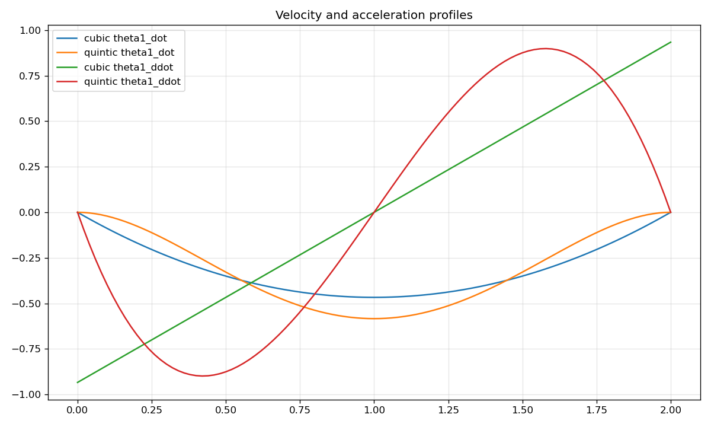

# Lab 1: 2-link 평면 로봇 팔

[English](GALLERY.md) · [한국어](GALLERY.ko.md) · [简体中文](GALLERY.zh-CN.md)

관절 운동이 말단의 정사각형 경로를 만드는 과정을 관찰하세요. 특히 모서리에서의 움직임을 비교하세요.

[원본 영상 / 이미지](media/c1_draw_square.mp4)

## 그래프

원시 데이터 (선택)

- [media/c1_draw_square.json](media/c1_draw_square.json)

