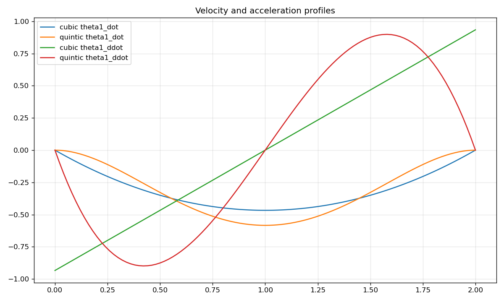

# Lab 1: 2-Link Planar Arm

[English](GALLERY.md) · [한국어](GALLERY.ko.md) · [简体中文](GALLERY.zh-CN.md)

Watch how joint motion produces a square end-effector path, especially at the corners.

[Source recording / image](media/c1_draw_square.mp4)

## Plots

Raw data (optional)

- [media/c1_draw_square.json](media/c1_draw_square.json)

