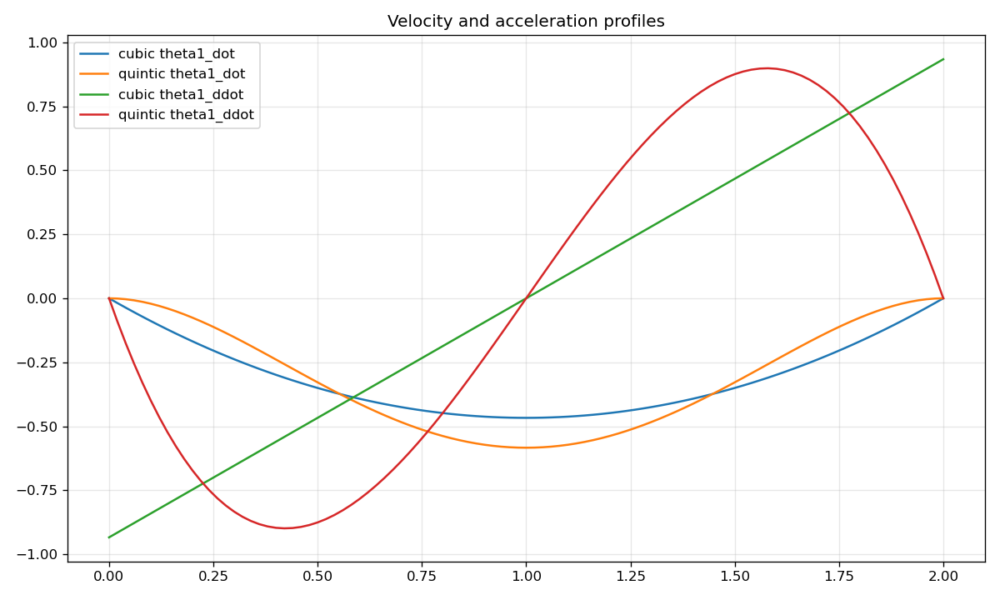

# Lab 1: 二连杆平面机械臂

[English](GALLERY.md) · [한국어](GALLERY.ko.md) · [简体中文](GALLERY.zh-CN.md)

观察关节运动如何形成末端的正方形路径，尤其注意转角处的运动。

[原始视频 / 图像](media/c1_draw_square.mp4)

## 图表

原始数据（可选）

- [media/c1_draw_square.json](media/c1_draw_square.json)

