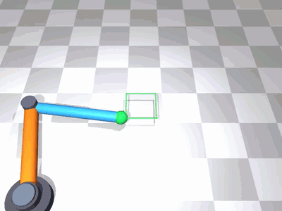

# Lab 1: 2-Link Planar Arm

[English](README.md) · [한국어](README.ko.md) · [简体中文](README.zh-CN.md)

Derive FK, Jacobians, Inverse Kinematics and PD control on a planar arm.



Watch how joint motion produces a square end-effector path, especially at the corners.

[Demo](GALLERY.md) · [Study notes](docs/README.md)

## Run

[Setup](../docs/SETUP.md)

```bash
mjpython lab-1-2link-arm/src/c1_draw_square.py
```

```bash
python -m pytest lab-1-2link-arm/tests -q
```

[← Curriculum](../README.md)
