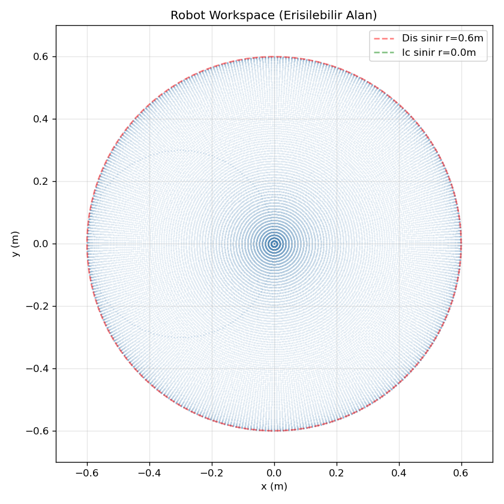
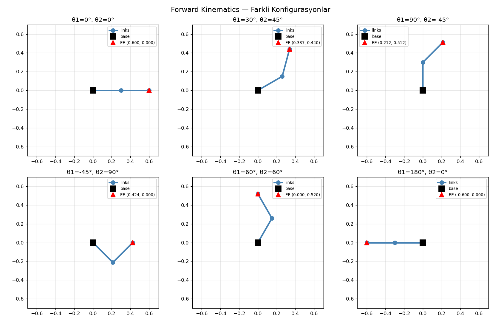

# A2: Forward Kinematics — Study Notes

[English](a2_forward_kinematics.md) · [한국어](a2_forward_kinematics.ko.md) · [简体中文](a2_forward_kinematics.zh-CN.md)

FK는 관절각에서 끝점 위치를 구합니다. 두 번째 joint 각도는 첫 link에 대한 상대각이므로 끝 link의 절대각은 `θ1+θ2`입니다. 실제 site와 비교할 때 `L1=0.3`, `L2_eff=0.315` m를 사용합니다.

```text
x = L1 cos(θ1) + L2_eff cos(θ1+θ2)
y = L1 sin(θ1) + L2_eff sin(θ1+θ2)
T02 = T01 T12
```

평면 homogeneous transform은 3×3이며 회전과 이동을 함께 표현합니다. Link별 변환을 곱해 얻은 끝점과 삼각함수 계산은 같아야 합니다. 30°·45°에서 tool을 포함하면 약 `(0.3413,0.4543)` m입니다. Link 끝만 계산한 값과 site를 혼동하지 마세요.

같은 q를 MuJoCo에 설정하고 `mj_forward` 후 `site_xpos`와 비교합니다. 전체 회전이 허용된 기하학적 workspace 반경은 `|L1-L2_eff|=0.015`부터 `L1+L2_eff=0.615` m입니다. 관절 제한·충돌이 실제 사용 영역을 줄일 수 있습니다.




실습: 여러 각도에서 직접 FK·변환행렬·MuJoCo를 비교하고 tool offset을 빠뜨렸을 때 일정한 15 mm 오차가 생기는지 확인하세요.

[학습 노트](README.ko.md) · [실행 안내](../README.ko.md)
