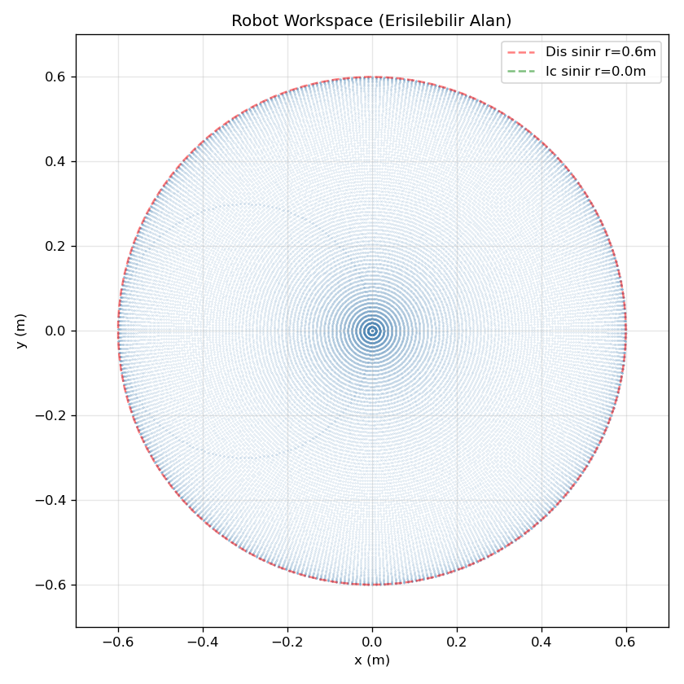
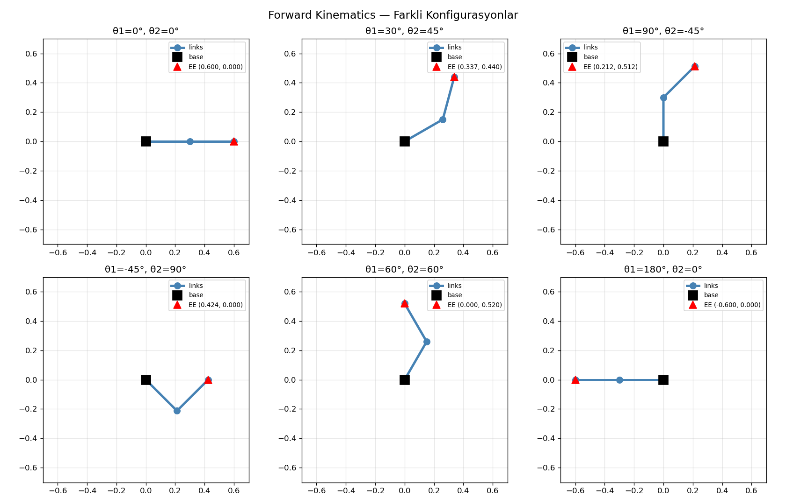

# A2: Forward Kinematics — Study Notes

[English](a2_forward_kinematics.md) · [한국어](a2_forward_kinematics.ko.md) · [简体中文](a2_forward_kinematics.zh-CN.md)

FK 从关节角计算末端位置。第二关节角相对第一 link，因此末段绝对角为 `θ1+θ2`。与实际 site 比较时使用 `L1=0.3`、`L2_eff=0.315` m。

```text
x = L1 cos(θ1) + L2_eff cos(θ1+θ2)
y = L1 sin(θ1) + L2_eff sin(θ1+θ2)
T02 = T01 T12
```

平面 homogeneous transform 是同时表示旋转和平移的 3×3 矩阵。逐 link 相乘的结果应与三角函数相同。30°/45° 加入 tool 后约为 `(0.3413,0.4543)` m；不要混淆 link 端点与 site。

在 MuJoCo 设置同一 q，调用 `mj_forward` 后比较 `site_xpos`。允许全角度旋转时，几何 workspace 半径为 `|L1-L2_eff|=0.015` 至 `L1+L2_eff=0.615` m；关节限制和碰撞会缩小可用区域。




练习：在多个角度比较手算 FK、变换矩阵与 MuJoCo，并检查遗漏 tool offset 是否产生 15 mm 误差。

[学习笔记](README.zh-CN.md) · [运行指南](../README.zh-CN.md)
