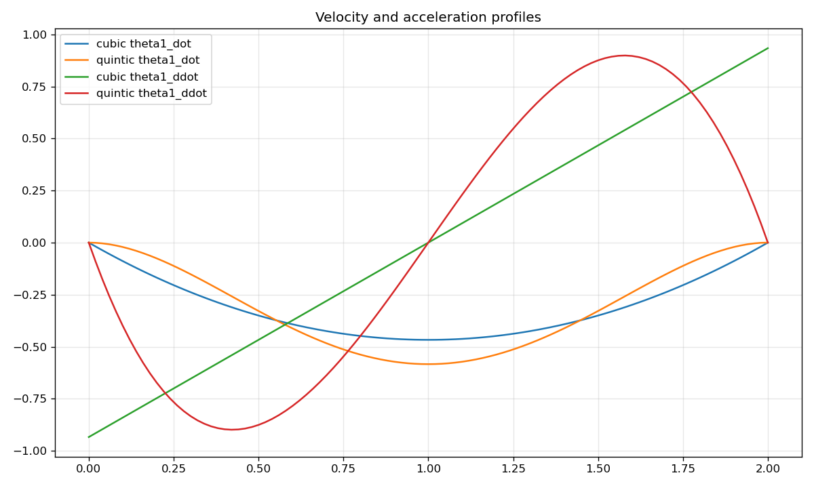
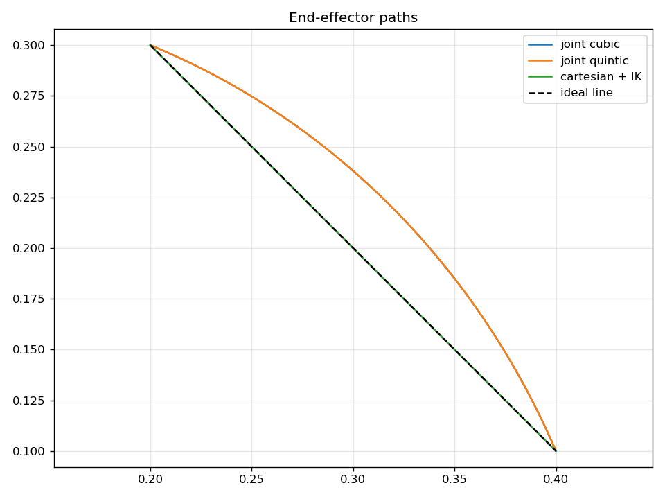

# B1: Trajectory Generation — Study Notes

[English](b1_trajectory_generation.md) · [한국어](b1_trajectory_generation.ko.md) · [简体中文](b1_trajectory_generation.zh-CN.md)

Joint-space 궤적은 q를 직접 보간하므로 간단하지만 끝점은 곡선을 그릴 수 있습니다. Cartesian 궤적은 끝점 목표를 보간하고 매 샘플 IK를 풉니다. 같은 시작·끝에서도 두 경로는 다릅니다.

Cubic은 양 끝 위치와 속도 0, quintic은 추가로 가속도 0을 만족합니다. `b1_trajectory_generation.py`는 cubic·quintic 관절 궤적과 analytic IK 분기를 선택한 Cartesian 직선을 생성합니다.

```text
q(t)=q0+(qf-q0)s(t/T)
s_cubic(u)=3u²-2u³
s_quintic(u)=10u³-15u⁴+6u⁵
```

`b1_*_traj.csv`와 다음 그림에서 위치·속도·가속도의 경계조건, Cartesian 직선 여부를 확인하세요. 궤적 생성만으로 torque·충돌 feasibility를 검증하지는 않습니다.




[학습 노트](README.ko.md) · [실행 안내](../README.ko.md)
