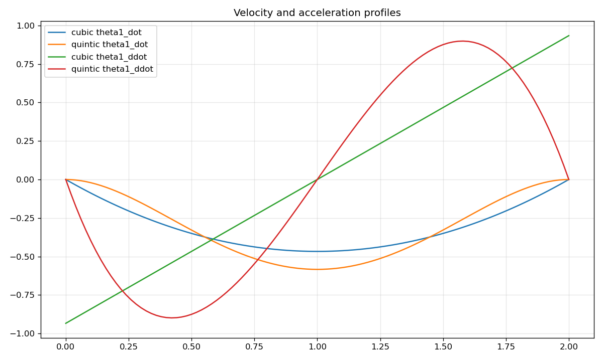
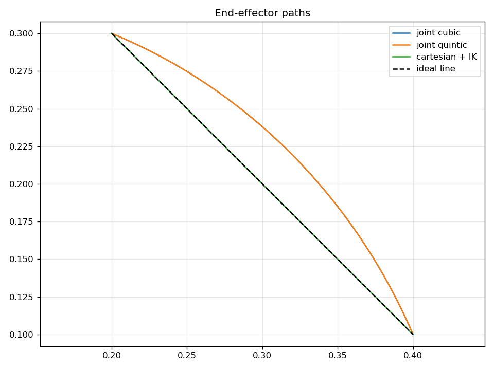

# B1: Trajectory Generation — Study Notes

[English](b1_trajectory_generation.md) · [한국어](b1_trajectory_generation.ko.md) · [简体中文](b1_trajectory_generation.zh-CN.md)

Joint-space 轨迹直接插值 q，简单但末端可能沿曲线运动；Cartesian 轨迹插值末端目标并逐样本求 IK。同一起终点可以得到不同路径。

Cubic 满足两端位置与零速度，quintic 额外满足零加速度。`b1_trajectory_generation.py` 生成 cubic/quintic 关节轨迹及选择 analytic IK 分支的 Cartesian 直线。

```text
q(t)=q0+(qf-q0)s(t/T)
s_cubic(u)=3u²-2u³
s_quintic(u)=10u³-15u⁴+6u⁵
```

在 `b1_*_traj.csv` 和下图检查位置/速度/加速度边界及 Cartesian 直线。生成轨迹本身不验证 torque 或碰撞可行性。




[学习笔记](README.zh-CN.md) · [运行指南](../README.zh-CN.md)
