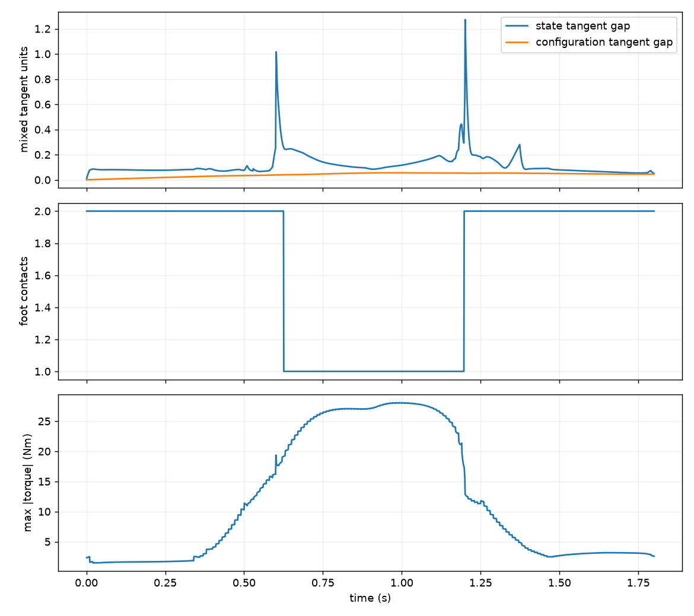
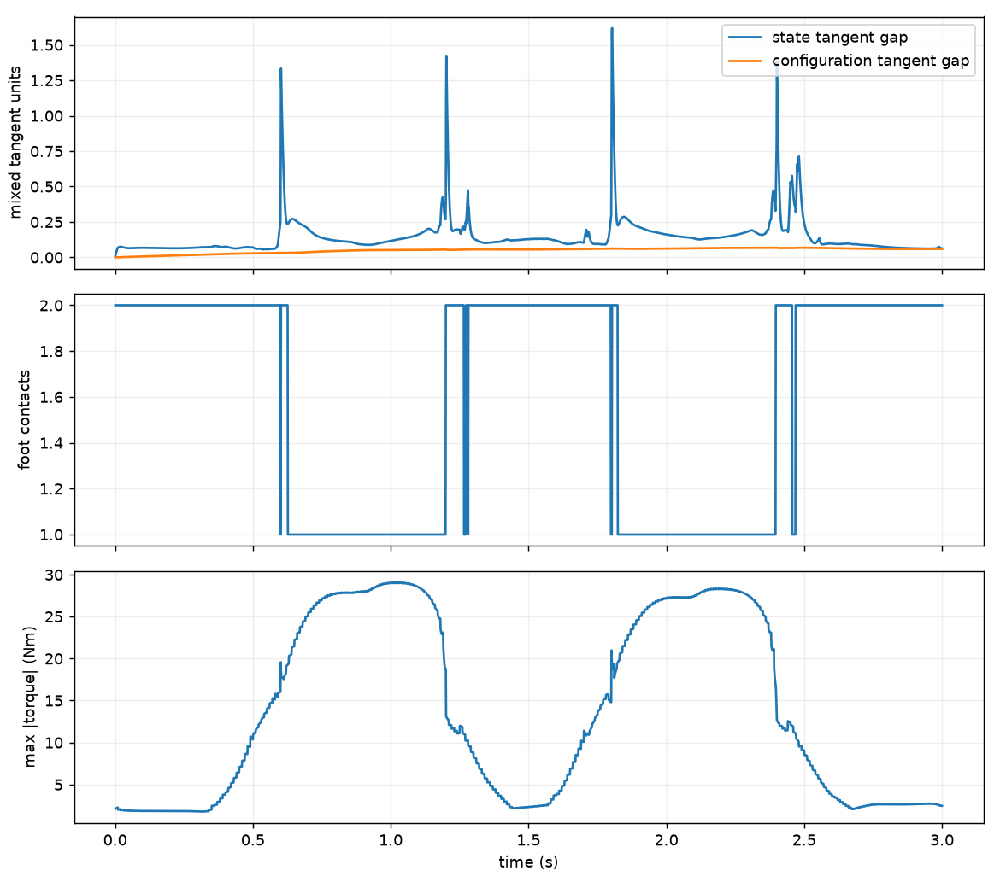

# Lab 10: Whole-body 최적제어

[English](GALLERY.md) · [한국어](GALLERY.ko.md) · [简体中文](GALLERY.zh-CN.md)

반투명 로봇은 0.25/0.50초 뒤의 최적화된 관절 자세입니다. 오프라인 기준 자세와 FDDP feedback으로 움직이는 로봇을 비교하세요.

[원본 영상 / 이미지](media/two_steps_validated/rollout.mp4)

## 그래프

원시 데이터 (선택)

- [one_step_validated/mujoco_summary.json](media/one_step_validated/mujoco_summary.json)
- [two_steps_validated/mujoco_summary.json](media/two_steps_validated/mujoco_summary.json)
- [validated_scenarios/matrix.json](media/validated_scenarios/matrix.json)

