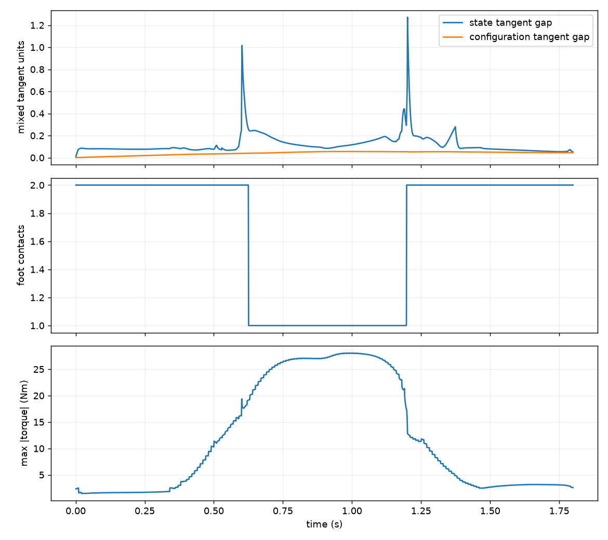
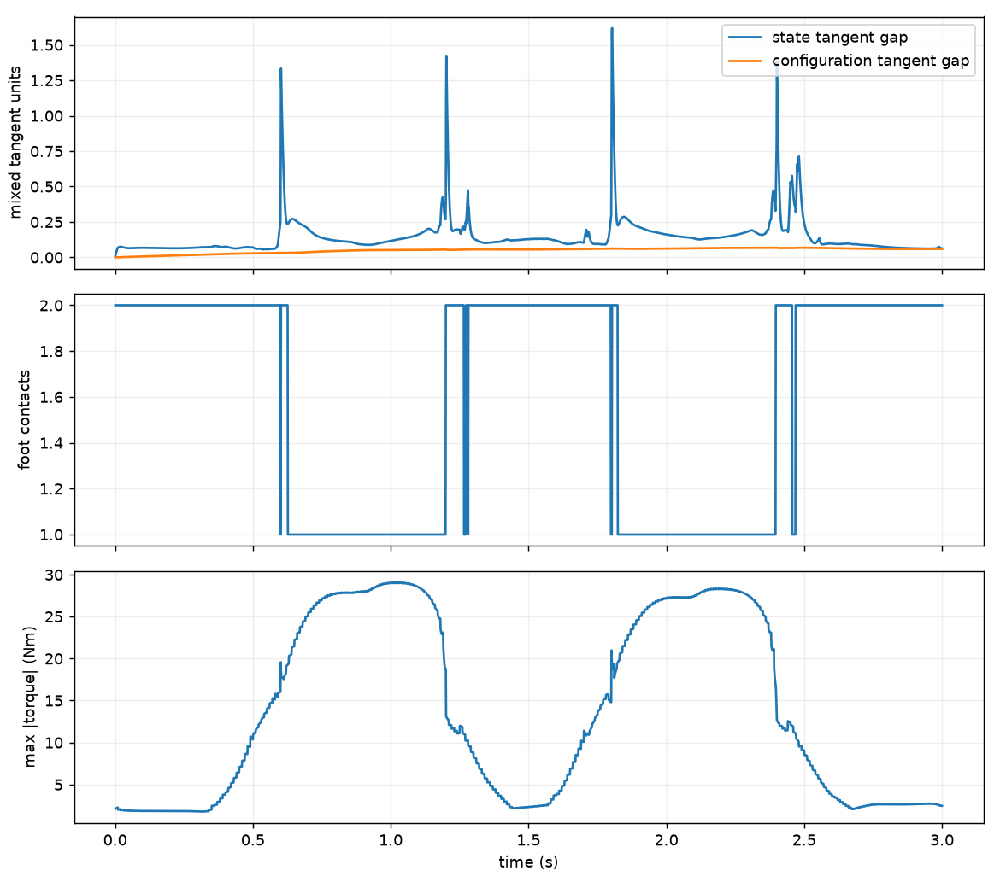

# Lab 10: Whole-Body Optimal Control

[English](GALLERY.md) · [한국어](GALLERY.ko.md) · [简体中文](GALLERY.zh-CN.md)

Close view, 0.65×: translucent robots show offline joint poses 0.25/0.50 s ahead. The solid robot tracks this plan with FDDP feedback.

[Source recording / image](media/two_steps_validated/rollout.mp4)

## Plots

Raw data (optional)

- [one_step_validated/mujoco_summary.json](media/one_step_validated/mujoco_summary.json)
- [two_steps_validated/mujoco_summary.json](media/two_steps_validated/mujoco_summary.json)
- [validated_scenarios/matrix.json](media/validated_scenarios/matrix.json)

