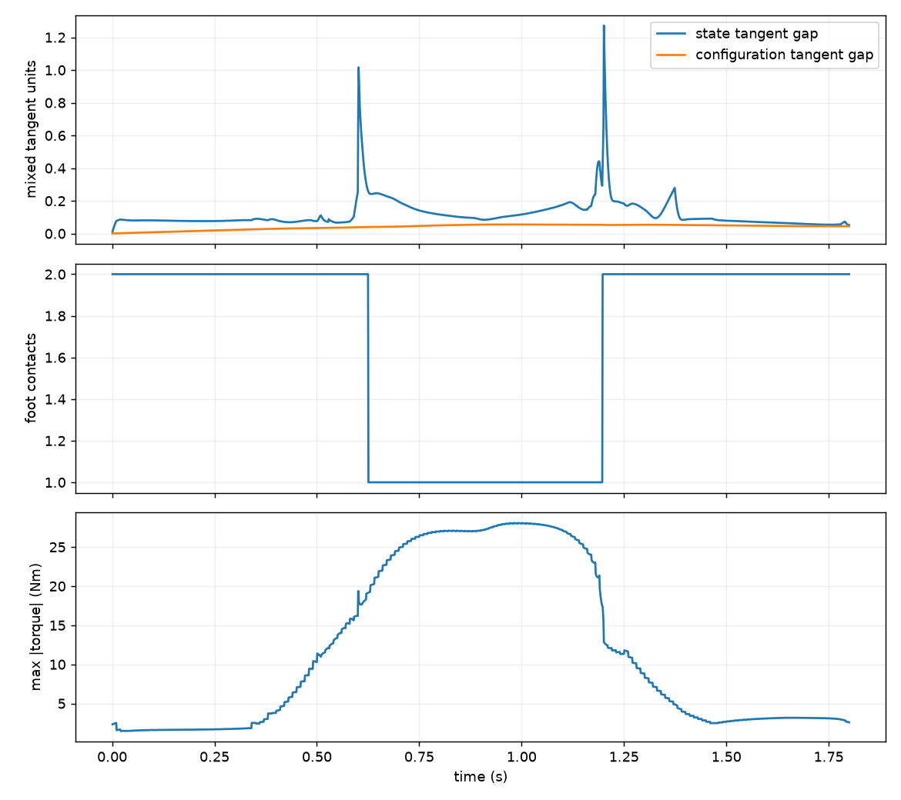
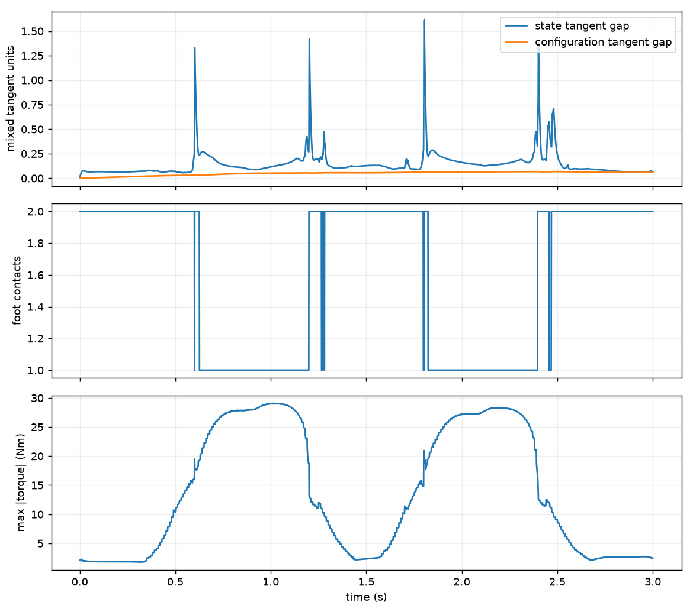

# Lab 10: 全身最优控制

[English](GALLERY.md) · [한국어](GALLERY.ko.md) · [简体中文](GALLERY.zh-CN.md)

半透明机器人显示提前 0.25/0.50 s 的优化关节姿态。比较离线参考姿态与 FDDP feedback 下的实体机器人。

[原始视频 / 图像](media/two_steps_validated/rollout.mp4)

## 图表

原始数据（可选）

- [one_step_validated/mujoco_summary.json](media/one_step_validated/mujoco_summary.json)
- [two_steps_validated/mujoco_summary.json](media/two_steps_validated/mujoco_summary.json)
- [validated_scenarios/matrix.json](media/validated_scenarios/matrix.json)

