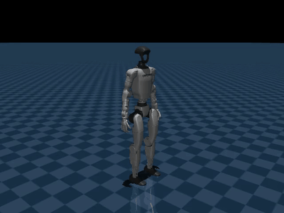

# Lab 10: 全身最优控制

[English](README.md) · [한국어](README.ko.md) · [简体中文](README.zh-CN.md)

使用 Box-FDDP 优化 contact/impact 动力学并在 MuJoCo 中跟踪。



半透明机器人显示提前 0.25/0.50 s 的优化关节姿态。两步 FDDP feedback 跟踪：最终足端误差 4.29 mm，无 flight/clipping tick。

[实验与测量](GALLERY.md) · [学习笔记](docs/README.md) · [可视化指南](../docs/VISUAL_GUIDE.zh-CN.md)

## 运行

[安装](../docs/SETUP.md)

```bash
.venv-ocp/bin/python lab-10-whole-body-optimal-control/src/whole_body_demo.py --steps 2 --mujoco --video
```

这是离线 OCP 加反馈，非 whole-body MPC。使用独立 OCP 环境和推荐规划成本。

```bash
.venv-ocp/bin/python -m pytest lab-10-whole-body-optimal-control/tests -q
```

[← Curriculum](../README.zh-CN.md)
