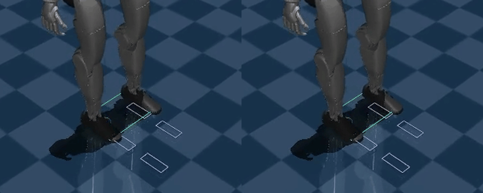

# Lab 11: 접촉을 고려한 보행

[English](GALLERY.md) · [한국어](GALLERY.ko.md) · [简体中文](GALLERY.zh-CN.md)

왼쪽은 기존 sine Swing, 오른쪽은 C2 Swing입니다. 같은 첫 걸음을 0.25배속으로 보며 발과 보라 기준 궤적이 착지에 접근하는 모습을 비교하세요. C2는 기준 궤적 끝점을 매끄럽게 하며, 충격 감소를 뜻하지는 않습니다.

[오른쪽 원본 영상](media/demo/walk.mp4)

[왼쪽 원본 영상](media/legacy/walk.mp4)

원시 데이터 (선택)

- [demo/summary.json](media/demo/summary.json)
- [legacy/summary.json](media/legacy/summary.json)

