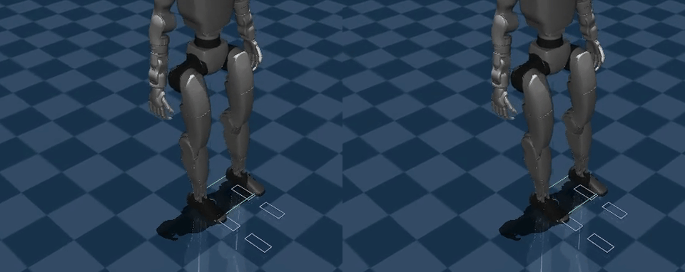

# Lab 12: 物理行走鲁棒性

[English](GALLERY.md) · [한국어](GALLERY.ko.md) · [简体中文](GALLERY.zh-CN.md)

左：无外力；右：持续 0.15 s 的 +10 N 侧向外力。相同控制器、同步 0.25 倍速播放，便于比较扰动响应；红色箭头表示实际施力时段。

[右侧原始视频](media/demo/walk.mp4)

[左侧原始视频](../lab-11-contact-transitions/media/demo/walk.mp4)

原始数据（可选）

- [demo/summary.json](media/demo/summary.json)
- [benchmark/matrix.json](media/benchmark/matrix.json)

