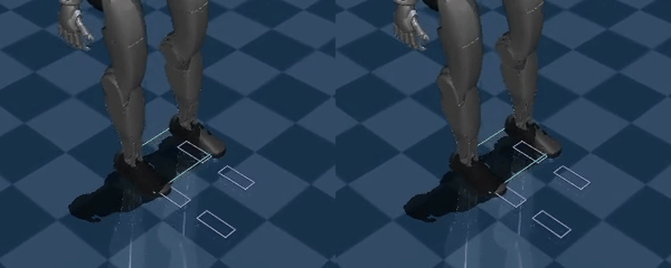

# Lab 13: Adaptive Foot Placement

[English](GALLERY.md) · [한국어](GALLERY.ko.md) · [简体中文](GALLERY.zh-CN.md)

Left: fixed footsteps. Right: adaptive placement under the same push (0.3×). On the right, the violet landing shifts 4 cm laterally away from the gray original footprint and the swing path updates; timing stays fixed. This shows a changed response, not superiority on every metric.

[Right recording](media/demo/walk.mp4)

[Left recording](../lab-12-walking-robustness/media/demo/walk.mp4)

Raw data (optional)

- [demo/summary.json](media/demo/summary.json)
- [benchmark/matrix.json](media/benchmark/matrix.json)

