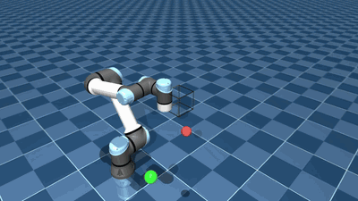

# Lab 2: UR5e Kinematics

[English](README.md) · [한국어](README.ko.md) · [简体中文](README.zh-CN.md)

Extend kinematics and trajectory tracking to a 6-DOF UR5e.



Follow the end effector along all 12 cube edges and observe how joint configurations change (3× playback).

[Demo](GALLERY.md) · [Study notes](docs/README.md)

## Run

[Setup](../docs/SETUP.md)

```bash
python lab-2-Ur5e-robotics-lab/src/c3_record_video.py
```

```bash
python -m pytest lab-2-Ur5e-robotics-lab/tests -q
```

[← Curriculum](../README.md)
