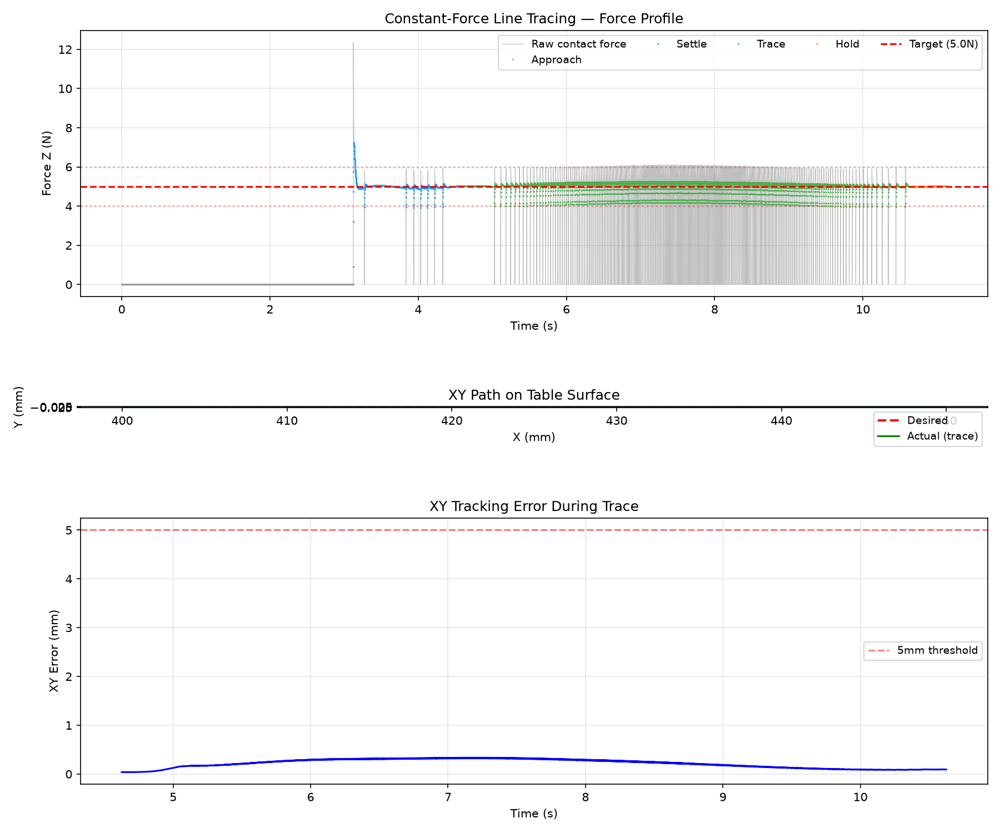

# Lab 3: Dynamics와 힘 제어

[English](GALLERY.md) · [한국어](GALLERY.ko.md) · [简体中文](GALLERY.zh-CN.md)

닫힌 그리퍼의 강체 probe가 평판을 따라 이동하면서 수직 접촉력 5 N을 유지하는 모습을 보세요(1배속).

[원본 영상 / 이미지](media/lab3_simulation.mp4)

## 그래프

원시 데이터 (선택)

- [media/line_trace_summary.json](media/line_trace_summary.json)
- [media/line_trace.csv](media/line_trace.csv)

