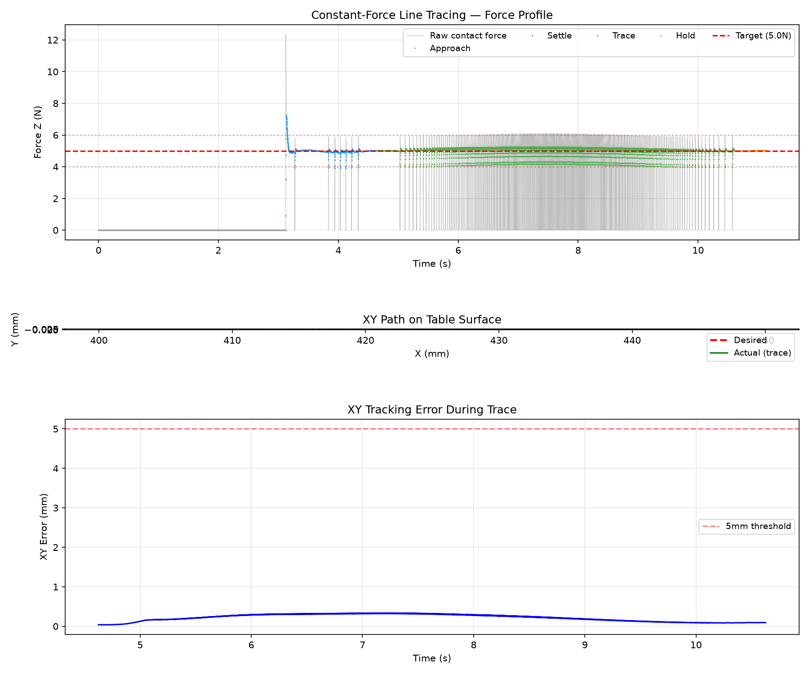

# Lab 3: Dynamics & Force Control

[English](GALLERY.md) · [한국어](GALLERY.ko.md) · [简体中文](GALLERY.zh-CN.md)

The closed gripper holds a rigid probe. Observe tangential motion along the plate while normal contact force tracks 5 N (1× playback).

[Source recording / image](media/lab3_simulation.mp4)

## Plots

Raw data (optional)

- [media/line_trace_summary.json](media/line_trace_summary.json)
- [media/line_trace.csv](media/line_trace.csv)

