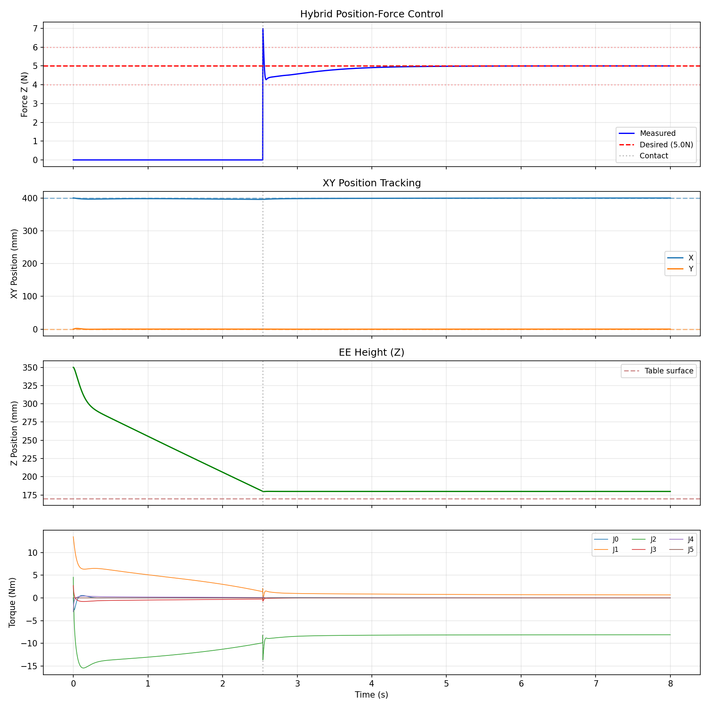
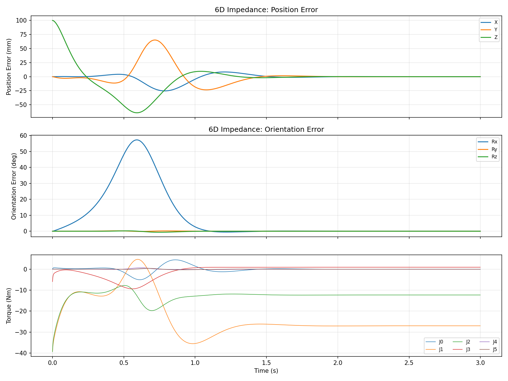

# Lab 3: Dynamics & Force Control

[English](README.md) · [한국어](README.ko.md) · [简体中文](README.zh-CN.md)

Contact line tracing; excerpt at 1.5×. Inspect force-error plots as well.

[Source recording / image](media/lab3_simulation.mp4)

## Exercises

### hybrid force control

### impedance 6d tracking

