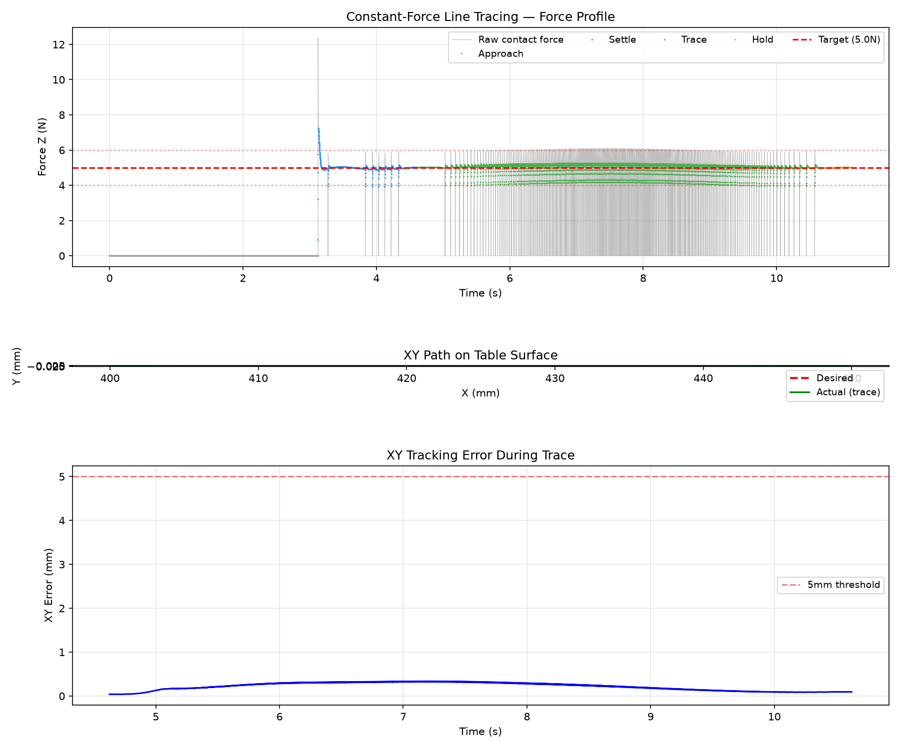

# Lab 3: 动力学与力控制

[English](GALLERY.md) · [한국어](GALLERY.ko.md) · [简体中文](GALLERY.zh-CN.md)

闭合夹爪装有刚性探针。观察沿平板的切向运动，以及法向接触力对 5 N 的跟踪（1 倍速）。

[原始视频 / 图像](media/lab3_simulation.mp4)

## 图表

原始数据（可选）

- [media/line_trace_summary.json](media/line_trace_summary.json)
- [media/line_trace.csv](media/line_trace.csv)

