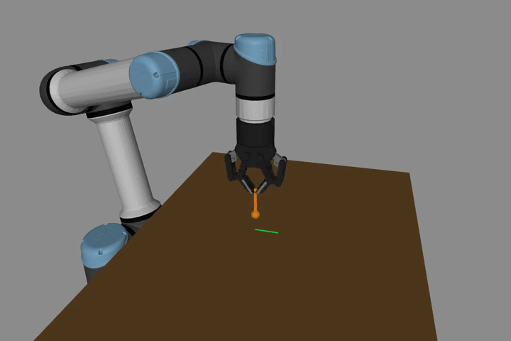

# Lab 3: Dynamics와 힘 제어

[English](README.md) · [한국어](README.ko.md) · [简体中文](README.zh-CN.md)

RNEA, CRBA, 중력 보상, impedance와 접촉력 제어를 익힙니다.



닫힌 그리퍼와 강체 probe로 평판(μ=0.05)에서 5 N·50 mm를 추종합니다. 전체 실행 1배속, 원시 접촉력 허용 구간 93.0%.

[실습과 측정 결과](GALLERY.md) · [학습 노트](docs/README.md)

## 실행

[설치](../docs/SETUP.md)

```bash
python lab-3-dynamics-force-control/src/record_lab3_demo.py
```

```bash
python -m pytest lab-3-dynamics-force-control/tests -q
```

[← Curriculum](../README.ko.md)
