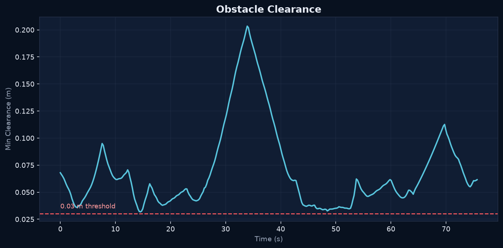
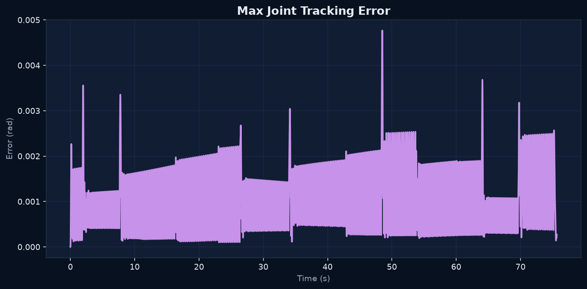

# Lab 4: Motion Planning

[English](GALLERY.md) · [한국어](GALLERY.ko.md) · [简体中文](GALLERY.zh-CN.md)

필수 직선 구간을 막는 기둥을 RRT*로 우회합니다. 계획 경로와 실제 로봇 움직임을 비교하세요(2배속).

[원본 영상 / 이미지](media/lab4_simulation.mp4)

## 그래프

원시 데이터 (선택)

- [media/slalom_summary.json](media/slalom_summary.json)
- [media/slalom.csv](media/slalom.csv)
- [media/planning_audit.json](media/planning_audit.json)
- [planning_benchmark/matrix.json](media/planning_benchmark/matrix.json)

