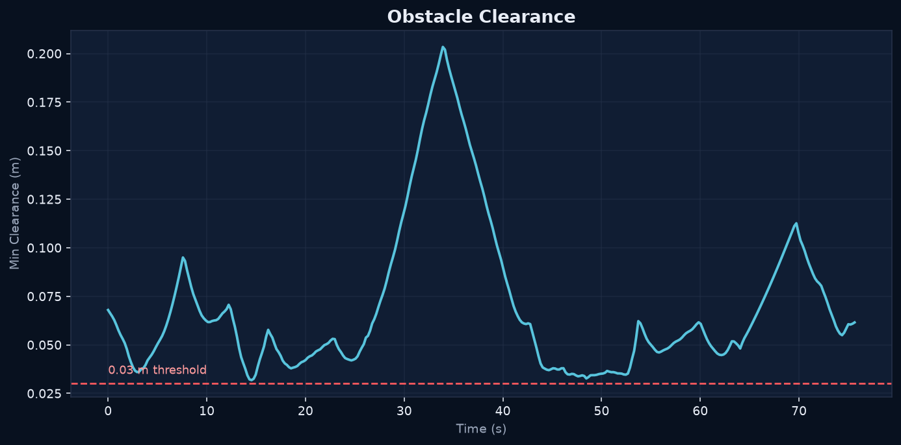
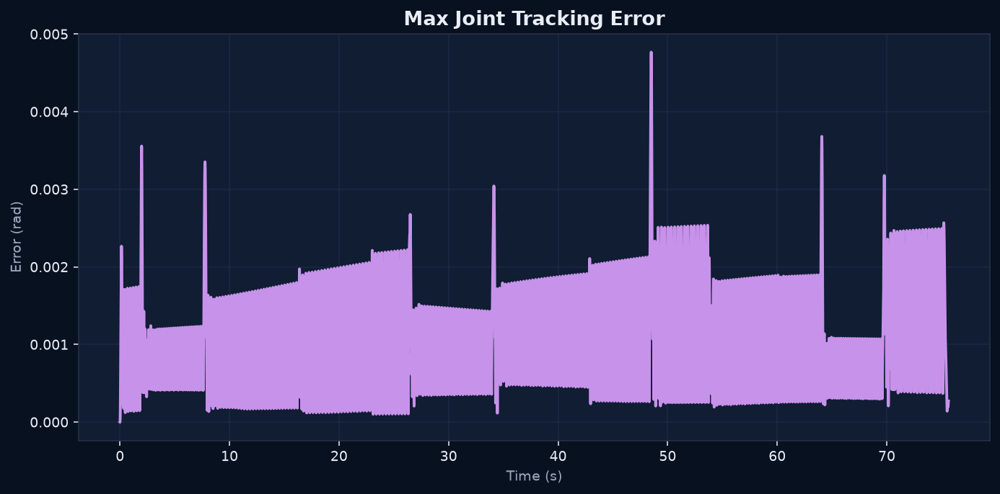

# Lab 4: Motion Planning

[English](README.md) · [한국어](README.ko.md) · [简体中文](README.zh-CN.md)

3D slalom at 2×: zero contacts, minimum obstacle clearance 30.35 mm. Collision shapes and visible meshes checked every 1 ms.

[Source recording / image](media/lab4_simulation.mp4)

## Measurements

- [media/slalom_summary.json](media/slalom_summary.json)

- [media/slalom.csv](media/slalom.csv)

## Exercises

### capstone clearance

### capstone tracking

