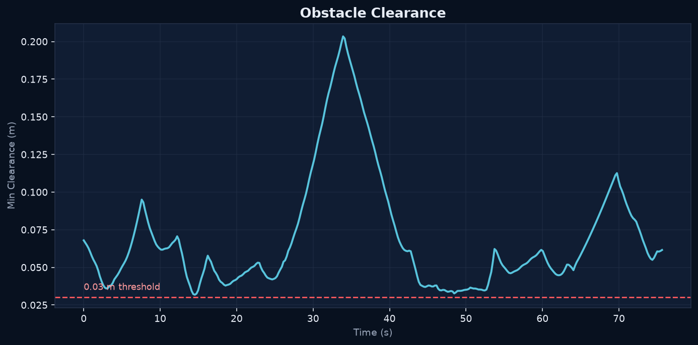
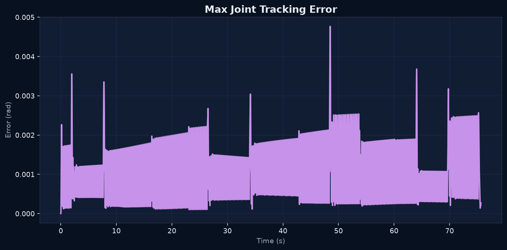

# Lab 4: 运动规划

[English](GALLERY.md) · [한국어](GALLERY.ko.md) · [简体中文](GALLERY.zh-CN.md)

RRT* 绕过阻挡必经直线段的柱体。比较规划路径与机器人的实际运动（2 倍速）。

[原始视频 / 图像](media/lab4_simulation.mp4)

## 图表

原始数据（可选）

- [media/slalom_summary.json](media/slalom_summary.json)
- [media/slalom.csv](media/slalom.csv)
- [media/planning_audit.json](media/planning_audit.json)
- [planning_benchmark/matrix.json](media/planning_benchmark/matrix.json)

