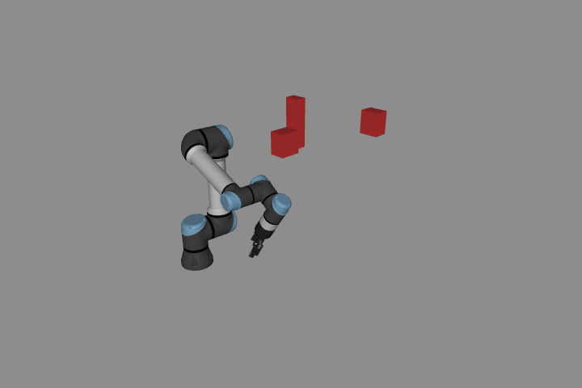
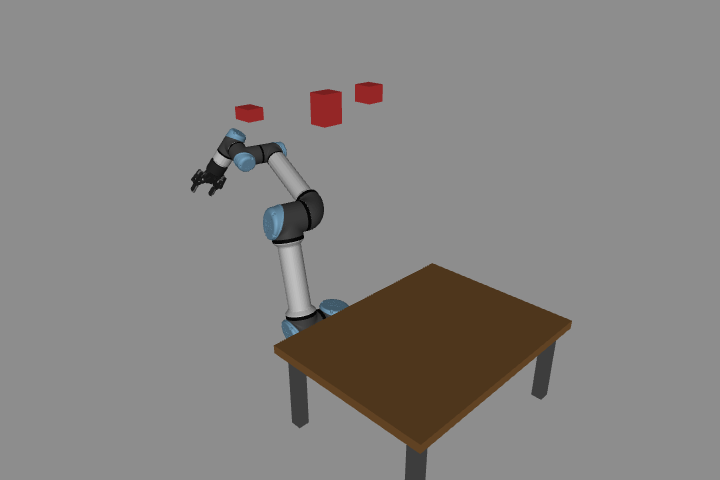
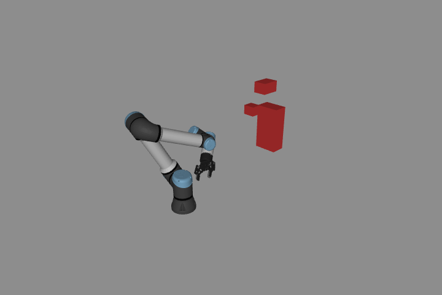
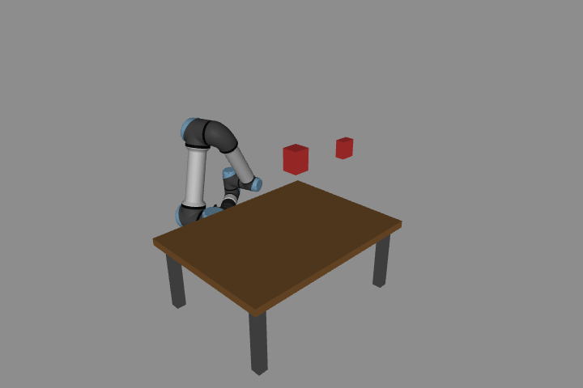
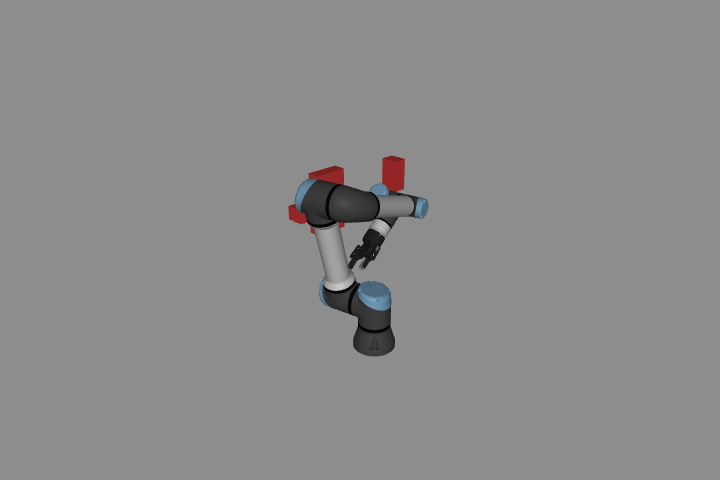
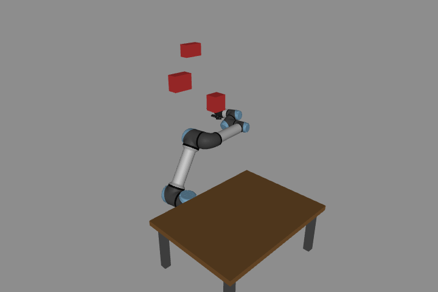

# 여러 환경에서의 RRT

[English](GENERALIZATION.md) · [한국어](GENERALIZATION.ko.md) · [简体中文](GENERALIZATION.zh-CN.md)

장애물과 시작·목표가 바뀌어도 사람이 우회 waypoint를 지정하지 않고 탐색해야 합니다. 이 실습은 고정 slalom 과제와 별도로 그 동작을 검사합니다. 모든 가능한 환경에서 성공한다는 주장은 아닙니다.

```bash
# From the repository root:
python lab-4-motion-planning/src/motion_planning.py \
  lab-4-motion-planning/scenarios/robot_101.json --seed 0 --execute
python lab-4-motion-planning/src/benchmark_planning.py
python lab-4-motion-planning/src/planning_scenarios.py --output /tmp/rrt-scenes
```

`motion_planning.py`는 scene JSON으로 관절 시작·목표, 선택적 탁자, 임의의 정적 axis-aligned box를 받습니다. `scenarios/`의 파일을 복사해 환경·끝점을 바꾸세요. 장애물 이름은 `obstacle_`로 시작하며 위치·half extent는 m, 관절각은 rad입니다. UR5e/Robotiq와 바닥 모델은 고정입니다. Cartesian IK·움직이는 장애물·임의 mesh 환경·온라인 재계획은 이 인터페이스의 범위 밖입니다.

어려운 사용자 환경에서는 `--max-iter`로 예산을 늘릴 수 있습니다. 공개 benchmark는 항상 고정된 1,500회 예산을 사용합니다.

## 공통 planner

RRT와 RRT* 모두 전체 실제 관절 범위, 1,500회 반복, extension 0.3 rad, rewiring 반경 0.7 rad, goal tolerance 0.15 rad를 사용합니다. 지정한 seed로 한 번만 실행합니다. 시작·목표 주변으로 탐색 영역을 제한하지 않으며 성공 seed를 찾기 위한 재시도도 없습니다.

샘플은 목표 20%, 시작·목표 보간점 주변 Gaussian 60%(표준편차 0.8 rad), **전체 관절 범위의 uniform 20%**를 섞습니다. 국소 샘플은 task 주변 탐색을 돕고, 남아 있는 global 샘플은 큰 우회를 허용합니다. 이는 샘플링 편향이며 환경을 쉬운 것으로 바꾸는 방식이 아닙니다. Slalom 녹화도 같은 탐색 설정과 고정 seed 42로 필수 task 구간을 계획합니다.

탐색은 바닥을 포함한 로봇·자기·환경 접촉과 표시 mesh의 장애물 여유 32 mm를 검사합니다. Edge 검사 간격은 최대 0.02 rad입니다. 실행 가능한 궤적을 반환하기 전에 raw·shortcut edge를 0.005 rad로, quintic reference를 10 ms 이하 간격으로 독립 검사하며 관절·속도·가속도 한계도 확인합니다. 승인 간격은 30 mm입니다. Quintic 시간 매개화는 joint-space polyline 형상을 유지합니다. 유한 샘플 검사는 연속시간 무충돌 증명이 아닙니다. Mesh 거리는 MuJoCo convex hull 기준이며 self-collision 제외 규칙은 모델별입니다. 검사 cache는 정적 장면에만 유효합니다.

## 고정 평가 조건

- 2D 점 로봇 6개 환경: 빈 공간·큰 우회·좁은 비대칭 통로·엇갈린 문·통과 불가능한 벽·충돌하는 목표입니다. 선분/rectangle 교차를 해석적으로 검사하며, 가능한 경우 명시적 witness path가 있습니다. 벽은 제한된 공간 전체를 가로막습니다. 좁은 통로는 **2D 검사**이며 실제 UR5e 전체 형상의 좁은 통로 성능을 뜻하지 않습니다.
- UR5e 6개 환경은 geometry seed 101–106, 상자 3개씩으로 관절 시작·목표와 장애물 위치·크기를 바꿉니다. 번갈아 탁자를 포함합니다. 생성기는 endpoint가 안전하고 직선이 상자와 실제 충돌하며 상자를 제거하면 통과하는 경우를 만듭니다. Planner를 실행해 성공할 장면만 고르지 않으며, 우회 경로의 존재는 처음에 알 수 없습니다.
- 모든 환경에 RRT/RRT*와 seed 0·7·23·42·91을 적용한 **120회**를 빠짐없이 기록합니다. 입력 JSON hash도 저장합니다.
- 물리 실행은 모든 UR5e 환경에서 RRT* seed 0을 미리 지정합니다. 같은 장면에서 PD + gravity compensation으로 1 ms 실행합니다. 좋은 seed 선별·contact 비활성화·실제 상태를 nominal로 덮어쓰는 처리는 없습니다.

평가한 여섯 장면의 시작 자세입니다. MuJoCo 렌더이며 실행 결과 영상은 아닙니다.













## 실습

복사한 장면에서 장애물 하나의 위치나 크기를 바꾸고 같은 seed·탐색 예산으로 RRT와 RRT*를 비교하세요. Seed를 바꿔 샘플링에 따른 차이도 관찰하세요. 통과 불가능한 환경에서는 실행 가능한 궤적을 반환하지 않는지도 확인하세요.

`success`는 반환 reference가 검사를 통과했다는 뜻이며 실제 추종과는 별도입니다. `invalid_start`/`invalid_goal`은 잘못된 endpoint입니다. `budget_exhausted`는 예산 안에 해를 찾지 못했다는 뜻이지 **경로가 없다는 증명은 아닙니다**. `audit_rejected`는 독립 검사에서 후보 경로를 거부한 경우입니다.

RRT는 첫 해에서 반환하고 RRT*는 반복 예산까지 탐색합니다. 종료 정책의 차이를 고려해 경로 품질을 비교하세요. [선택 참고 데이터](../media/planning_benchmark/matrix.json)는 모든 시도를 포함하며, 행렬 수준의 `passed`가 모든 질의의 경로 탐색 성공을 뜻하지는 않습니다.

[학습 노트](README.ko.md) · [실행 안내](../README.ko.md)
