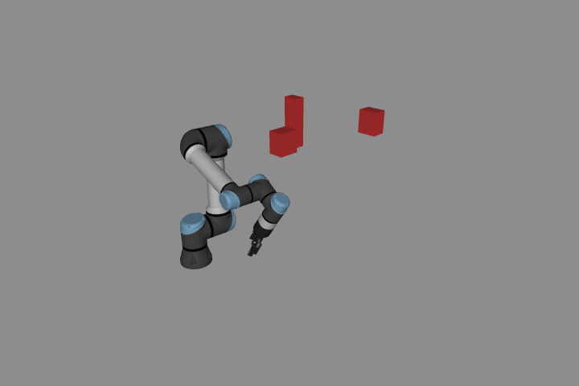
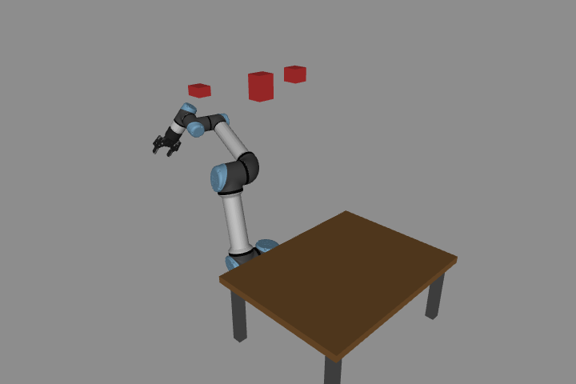
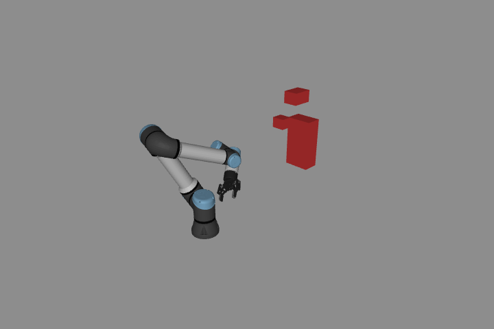
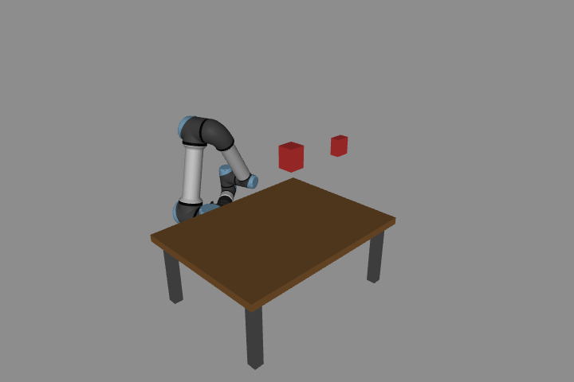
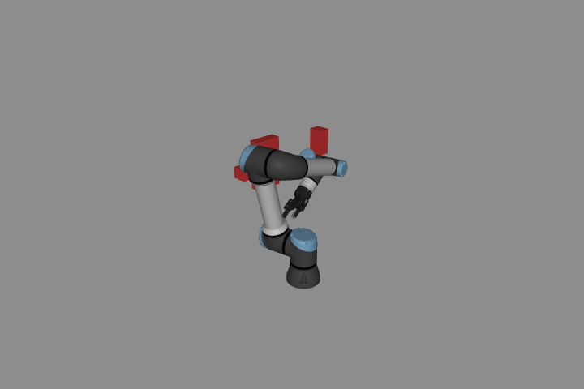
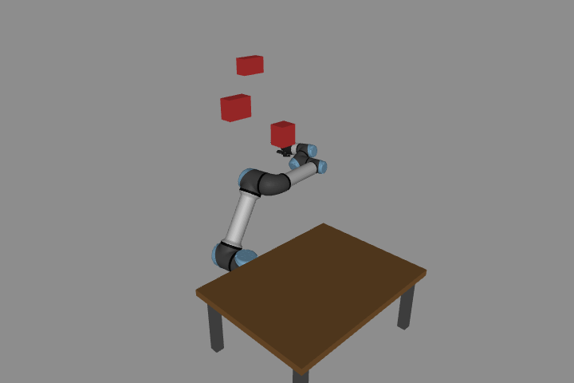

# RRT across environments

[English](GENERALIZATION.md) · [한국어](GENERALIZATION.ko.md) · [简体中文](GENERALIZATION.zh-CN.md)

An algorithm must handle changed geometry and endpoints without a hand-authored detour. This exercise tests that behavior separately from the fixed slalom task. It does not claim success in every possible environment.

```bash
# From the repository root:
python lab-4-motion-planning/src/motion_planning.py \
  lab-4-motion-planning/scenarios/robot_101.json --seed 0 --execute
python lab-4-motion-planning/src/benchmark_planning.py
python lab-4-motion-planning/src/planning_scenarios.py --output /tmp/rrt-scenes
```

`motion_planning.py` accepts joint-space start/goal, an optional table and arbitrary static axis-aligned boxes in a scene JSON. Copy a file from `scenarios/` and change the geometry or endpoints. Names must start with `obstacle_`; positions and half extents use meters, joint angles use radians. The UR5e/Robotiq model and ground remain fixed. Cartesian IK, moving obstacles, arbitrary mesh environments and online replanning are outside this interface.

You can increase `--max-iter` for a difficult user scene; the published benchmark always uses the fixed 1,500-iteration budget.

## Shared planner

Both RRT and RRT* use the same full physical joint limits, 1,500 iterations, 0.3 rad extension, 0.7 rad rewiring radius and 0.15 rad goal tolerance. Each query runs exactly once for its specified seed. There is no restricted start/goal sampling box and no successful-seed retry.

Sampling mixes 20% goal, 60% Gaussian samples around interpolated start/goal configurations (standard deviation 0.8 rad), and 20% uniform samples over **all joint limits**. The local component helps exploration near the task; the nonzero global component still allows large detours. This is a sampling bias, not a replacement of the environment by an easier one. The slalom recorder uses these same search settings, with a fixed seed 42 for its required task segments.

Search checks robot/self/environment contacts, including the ground, plus visible-mesh obstacle clearance at 32 mm. Edges are sampled at at most 0.02 rad. Before returning an executable trajectory, independent checks inspect raw and shortcut edges at 0.005 rad, every 10 ms-or-finer quintic reference, joint limits and velocity/acceleration limits. Accepted obstacle clearance is 30 mm. Quintic timing preserves the joint-space polyline. These sampled checks are not a formal continuous-collision certificate. Mesh distance uses MuJoCo convex hulls; self-collision exclusions remain model-specific. Cached checks apply only to a static scene.

## Fixed evaluation protocol

- Six 2D point-robot scenes: free space, a wide detour, a narrow offset gap, staggered gates, an impassable wall and a colliding goal. Exact segment/rectangle intersection checks edges. Feasible cases include explicit witness paths; the wall spans the entire bounded domain. The narrow-gap test is **2D**, not a claim about a narrow passage for the full UR5e.
- Six UR5e scenes use geometry seeds 101–106, three boxes each, changing both joint endpoints and obstacle sizes/positions; alternating scenes include a table. Generation accepts only clear endpoints and a direct path that is physically blocked by boxes but becomes clear when boxes are removed. It never runs the planner to select cases. Detour feasibility is initially unknown.
- Each scene uses RRT and RRT* with seeds 0, 7, 23, 42, 91: **120 queries**, all retained. The input JSON hashes are stored in the result.
- For physical validation, RRT* seed 0 is selected in advance for all six robot scenes. The same geometry is executed at 1 ms with PD + gravity compensation. No best-seed selection, contact disabling or nominal-state overwrite is used.

Starting configurations of the six evaluated scenes (native MuJoCo renders; not execution recordings).













## Try it

Change one obstacle's position or size in a copied scene, then compare RRT and RRT* with the same seed and search budget. Repeat with different seeds to observe sampling variability. Include an impassable case and check that no executable trajectory is returned.

`success` means the returned reference passed the checks; physical tracking is a separate question. `invalid_start`/`invalid_goal` indicate invalid endpoints. `budget_exhausted` means no solution was found within the budget, **not proof that none exists**. `audit_rejected` means an independent check rejected a candidate.

RRT returns the first solution; RRT* continues through its iteration budget. Compare path quality with this stopping-policy difference in mind. The [optional run data](../media/planning_benchmark/matrix.json) contain all attempts; a matrix-level `passed` does not mean every query returned a path.

[Study notes](README.md) · [Run guide](../README.md)
