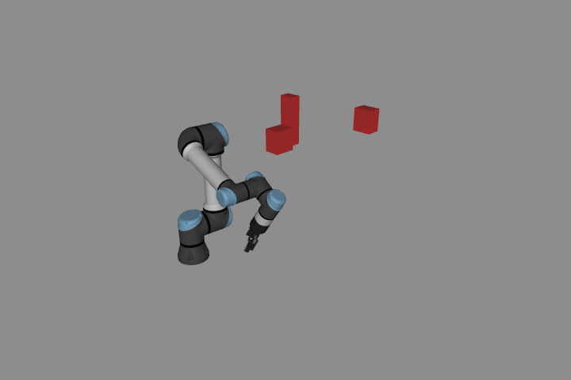
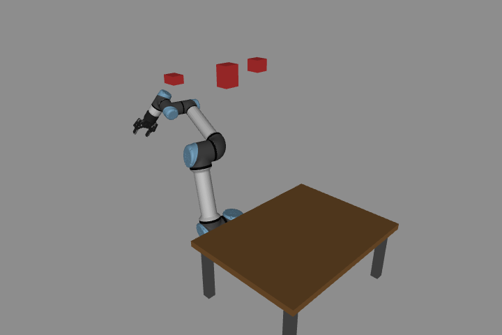
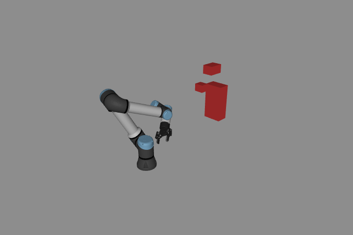
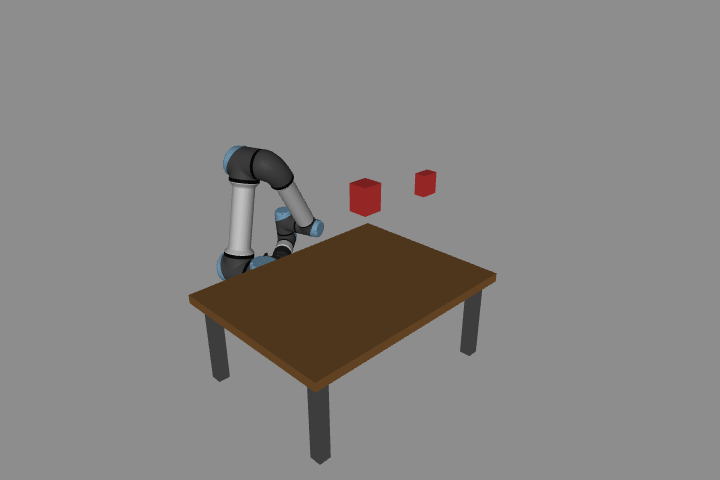
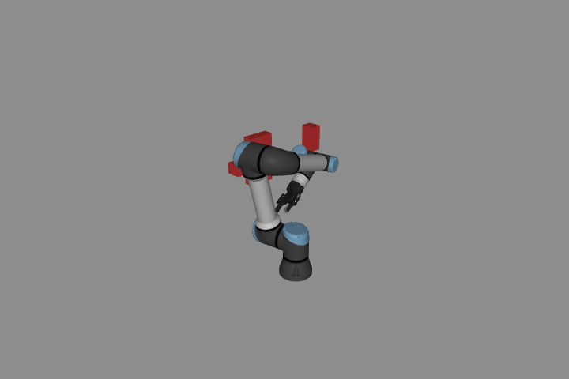
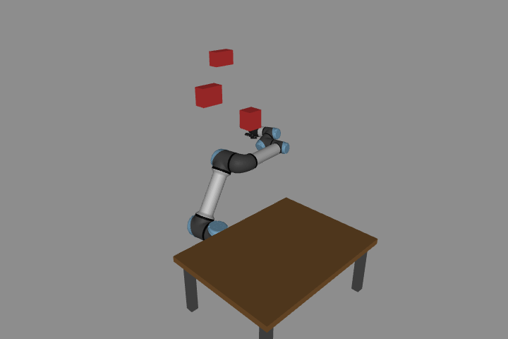

# 多环境 RRT

[English](GENERALIZATION.md) · [한국어](GENERALIZATION.ko.md) · [简体中文](GENERALIZATION.zh-CN.md)

障碍物和起终点改变后，应无需手写绕行 waypoint 即可搜索。本实验将这一能力与固定 slalom 任务分开验证，并不声称对所有环境都成功。

```bash
# From the repository root:
python lab-4-motion-planning/src/motion_planning.py \
  lab-4-motion-planning/scenarios/robot_101.json --seed 0 --execute
python lab-4-motion-planning/src/benchmark_planning.py
python lab-4-motion-planning/src/planning_scenarios.py --output /tmp/rrt-scenes
```

`motion_planning.py` 从 scene JSON 读取关节起终点、可选桌子和任意静态 axis-aligned box。复制 `scenarios/` 文件后修改几何或端点。障碍名以 `obstacle_` 开头，位置/half extent 单位为 m，关节角为 rad。UR5e/Robotiq 与地面模型固定；Cartesian IK、移动障碍、任意 mesh 环境及在线重规划不在此接口范围内。

对于困难的自定义环境，可用 `--max-iter` 增加预算；公开 benchmark 始终使用固定的 1,500 次迭代。

## 共用 planner

RRT/RRT* 使用完整实际关节范围、1,500 次迭代、0.3 rad extension、0.7 rad rewiring radius、0.15 rad goal tolerance。每个指定 seed 仅运行一次，不限制起终点周围采样区域，也不重试直到找到成功 seed。

采样混合 20% goal、60% 起终点插值附近 Gaussian（标准差 0.8 rad）、20% **全关节范围 uniform**。局部部分帮助 task 附近探索，保留的 global 部分允许大绕行。这是采样偏置，不是将环境换成更容易的场景。Slalom 录制也采用相同搜索配置，并为必经 task 区间固定 seed 42。

搜索检查机器人/自碰撞/环境接触（含地面），以及可见 mesh 的 32 mm 障碍间隙。Edge 采样不超过 0.02 rad。返回可执行轨迹前，以 0.005 rad 独立检查 raw/shortcut edge，检查每个不超过 10 ms 的 quintic reference 及关节/速度/加速度限制，要求间隙 30 mm。Quintic 保留 joint-space polyline 几何。有限采样不是连续无碰撞证明；mesh 距离使用 MuJoCo convex hull，自碰撞排除规则依赖模型。检查 cache 只适用于静态场景。

## 固定评估协议

- 六个 2D 点机器人环境：空旷、大绕行、狭窄偏置通道、交错门、不可通过墙、碰撞目标。使用精确线段/rectangle 相交检查；可行场景有明确 witness path，墙横跨整个有界空间。狭窄通道是 **2D 测试**，不代表完整 UR5e 的狭窄通道表现。
- 六个 UR5e 环境使用 geometry seed 101–106、各三个箱体，改变关节端点及箱体位置/尺寸，交替加入桌子。生成器要求端点安全、直线与箱体实际碰撞、移除箱体后可通过。它不运行 planner 来筛选成功场景，绕行可行性起初未知。
- 每个环境运行 RRT/RRT*，seed 为 0、7、23、42、91，共 **120 次**，全部保留，并记录输入 JSON hash。
- 预先选择每个 UR5e 环境的 RRT* seed 0 做物理执行，以相同几何、PD + gravity compensation、1 ms 步长运行。不挑最佳 seed、不禁用 contact、不以 nominal 覆盖实际状态。

六个评估场景的初始姿态（MuJoCo 原生渲染，并非执行录像）。













## 练习

复制场景后改变一个障碍物的位置或尺寸，用相同 seed 和搜索预算比较 RRT 与 RRT*。更换 seed 观察采样差异。也要包含无法通过的环境，检查其不返回可执行轨迹。

`success` 表示返回 reference 通过检查，实际跟踪需要另外判断。`invalid_start`/`invalid_goal` 表示端点无效。`budget_exhausted` 表示预算内没有找到解，**不证明路径不存在**。`audit_rejected` 表示独立检查拒绝候选路径。

RRT 找到首解即返回，RRT* 持续搜索至迭代预算。比较路径质量时应考虑停止策略的差异。[可选运行数据](../media/planning_benchmark/matrix.json)包含所有尝试，矩阵级 `passed` 不表示每次查询都找到路径。

[学习笔记](README.zh-CN.md) · [运行指南](../README.zh-CN.md)
