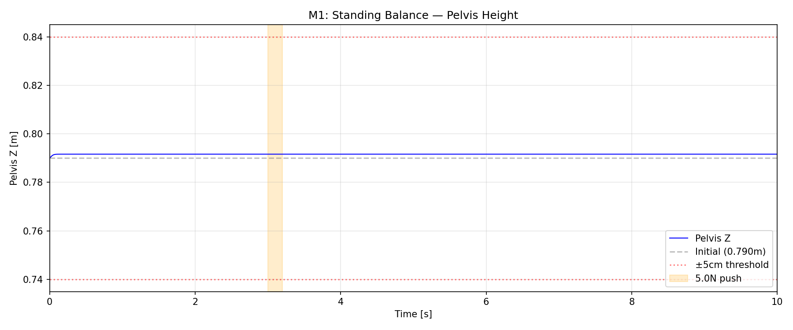
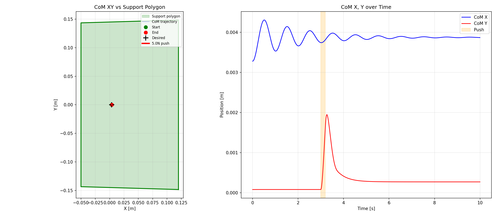
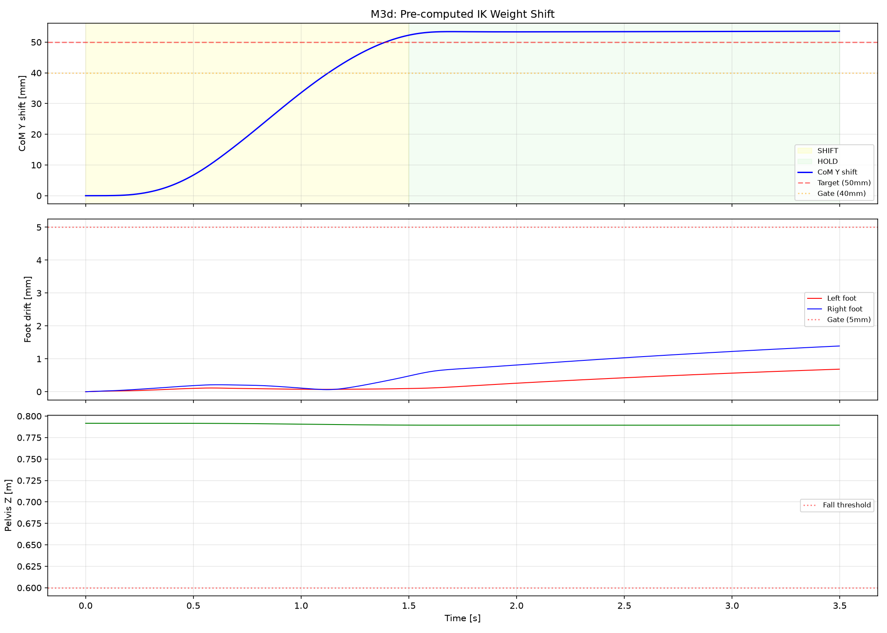

# Lab 5: 균형과 무게 이동

[English](GALLERY.md) · [한국어](GALLERY.ko.md) · [简体中文](GALLERY.zh-CN.md)

초록 지지 영역 안에서 청록 CoM 원이 흰 목표로 이동하는 모습을 보세요. 주황은 접촉 ZMP입니다.

[원본 영상 / 이미지](media/m3d_weight_shift.mp4)

## 그래프

원시 데이터 (선택)

- [media/m3d_weight_shift_summary.json](media/m3d_weight_shift_summary.json)

