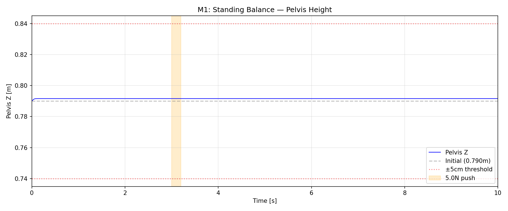
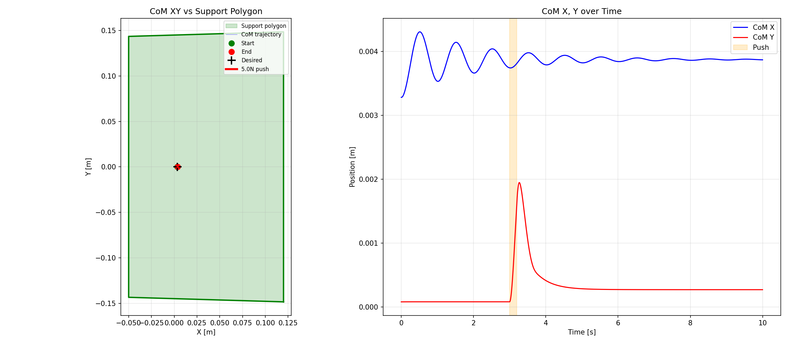
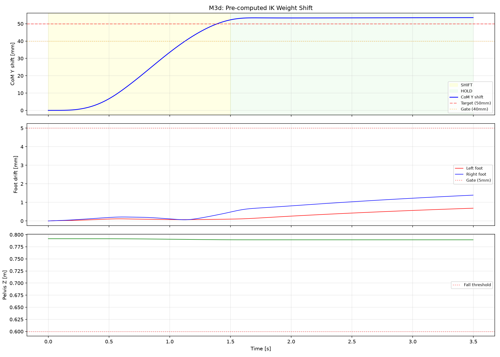

# Lab 5: Balance & Weight Shifting

[English](GALLERY.md) · [한국어](GALLERY.ko.md) · [简体中文](GALLERY.zh-CN.md)

Watch the cyan CoM ring move toward the white target inside green support; amber marks contact ZMP.

[Source recording / image](media/m3d_weight_shift.mp4)

## Plots

Raw data (optional)

- [media/m3d_weight_shift_summary.json](media/m3d_weight_shift_summary.json)

