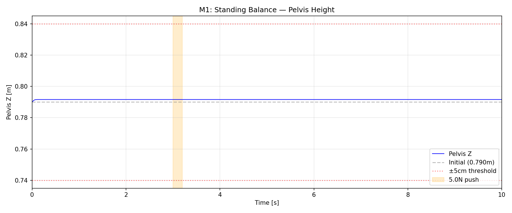
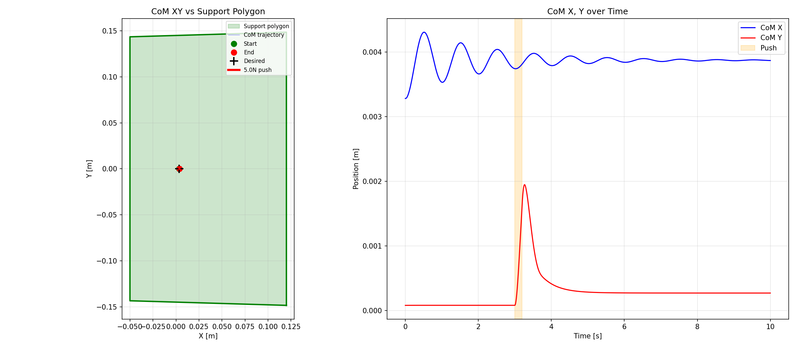
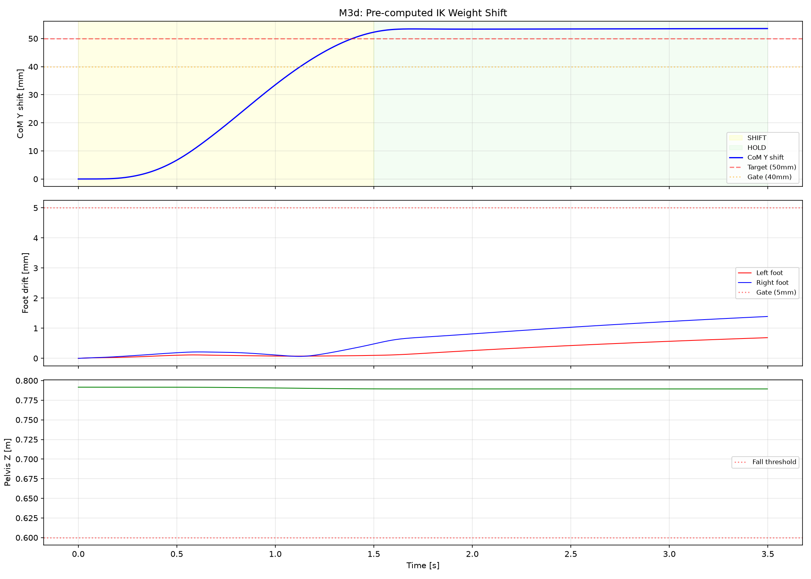

# Lab 5: 平衡与重心转移

[English](GALLERY.md) · [한국어](GALLERY.ko.md) · [简体中文](GALLERY.zh-CN.md)

观察青色 CoM 圆环在绿色支撑区域内移向白色目标；橙色为接触 ZMP。

[原始视频 / 图像](media/m3d_weight_shift.mp4)

## 图表

原始数据（可选）

- [media/m3d_weight_shift_summary.json](media/m3d_weight_shift_summary.json)

