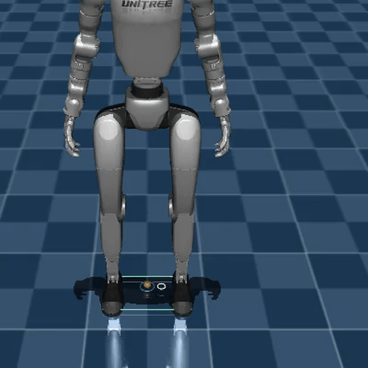

# Lab 5: 균형과 무게 이동

[English](README.md) · [한국어](README.ko.md) · [简体中文](README.zh-CN.md)

Floating-base 상태, CoM, Whole-body IK와 양발 접촉 균형을 익힙니다.



양발 접촉을 유지하는 준정적 무게 이동.

[실습과 측정 결과](GALLERY.md) · [학습 노트](docs/README.md)

## 실행

[설치](../docs/SETUP.md)

```bash
python lab-5-locomotion/src/m3d_weight_shift.py
```

준정적 균형 과정이며 torque 기반 동적 보행은 Lab 6에서 이어집니다.

```bash
python -m pytest lab-5-locomotion/tests -q
```

[← Curriculum](../README.ko.md)
