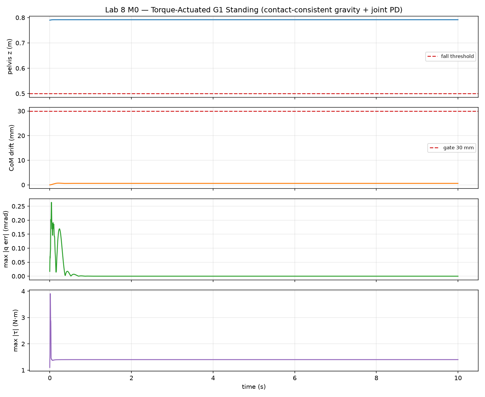
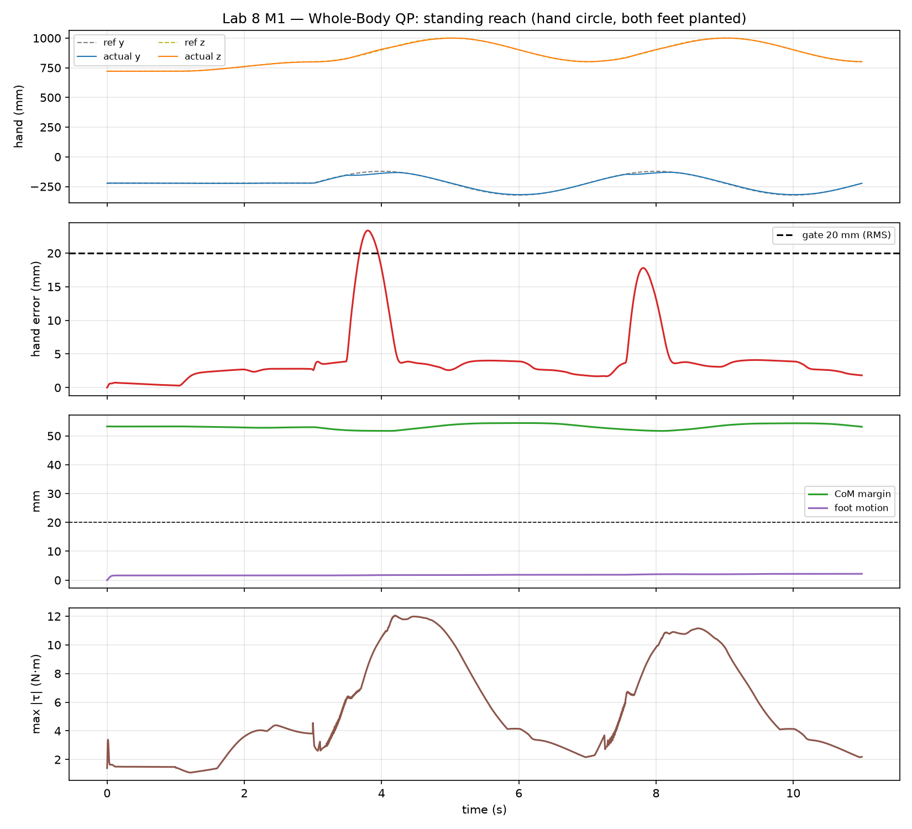
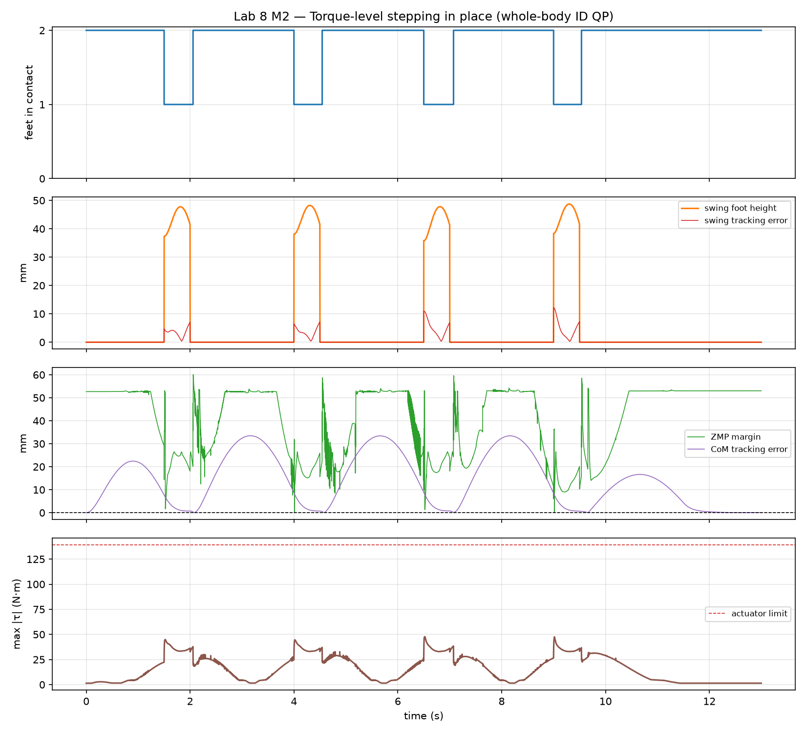
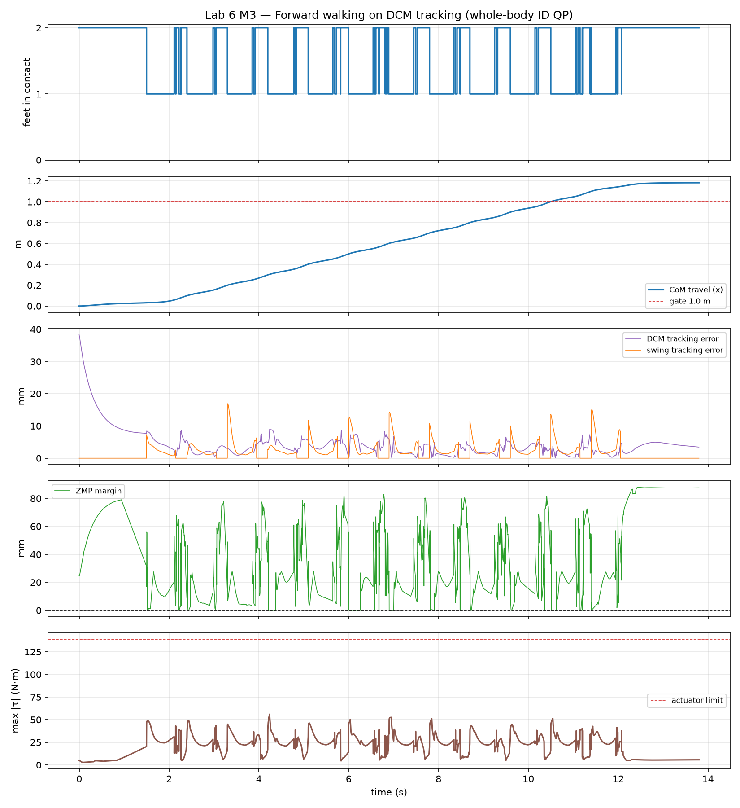

# Lab 6: Whole-body 보행 제어

[English](GALLERY.md) · [한국어](GALLERY.ko.md) · [简体中文](GALLERY.zh-CN.md)

한발·양발 지지 영역이 바뀔 때 DCM(보라)과 접촉 ZMP(주황)의 움직임을 보세요(1배속).

[원본 영상 / 이미지](media/m3_walking.mp4)

## 그래프

원시 데이터 (선택)

- [media/m3_walking_summary.json](media/m3_walking_summary.json)

