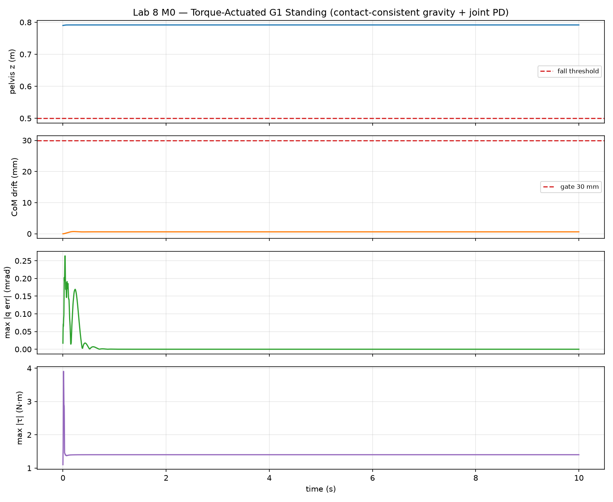
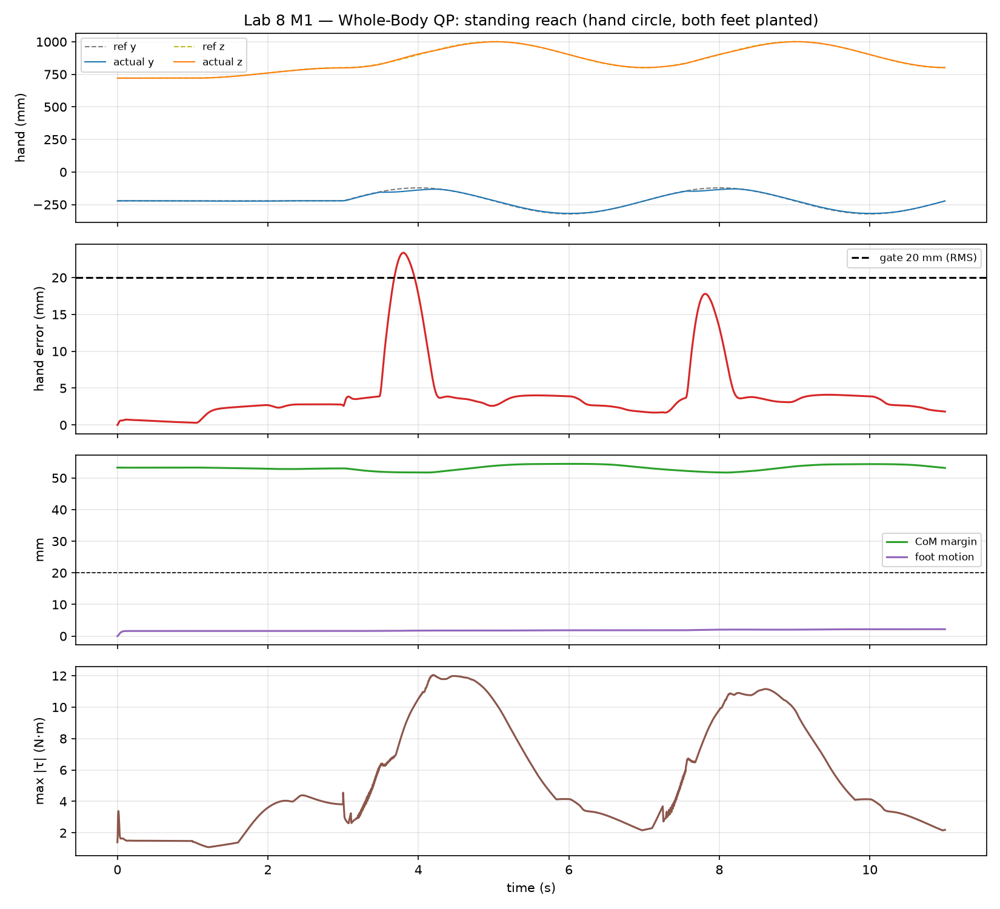
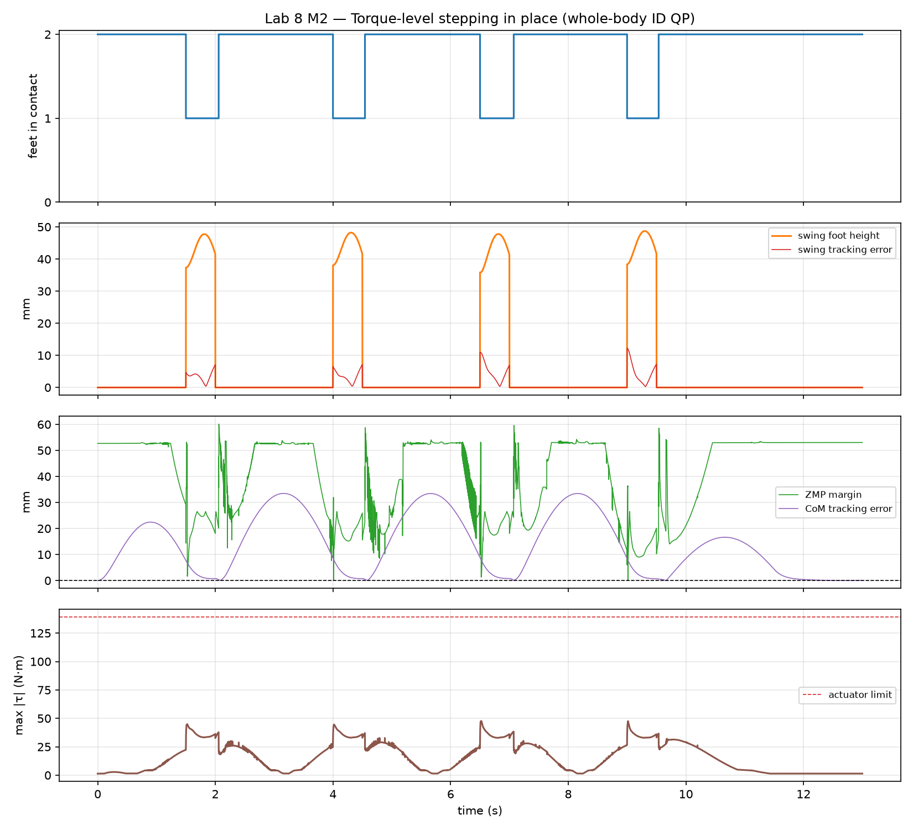
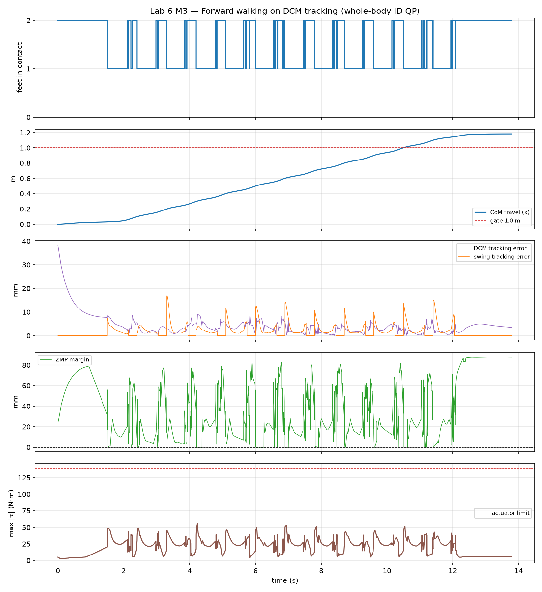

# Lab 6: Whole-Body Walking Control

[English](GALLERY.md) · [한국어](GALLERY.ko.md) · [简体中文](GALLERY.zh-CN.md)

Foot-level view, 0.65×: watch the loaded support hull change from two feet to one and back. Compare violet DCM with amber contact ZMP.

[Source recording / image](media/m3_walking.mp4)

## Plots

Raw data (optional)

- [media/m3_walking_summary.json](media/m3_walking_summary.json)

