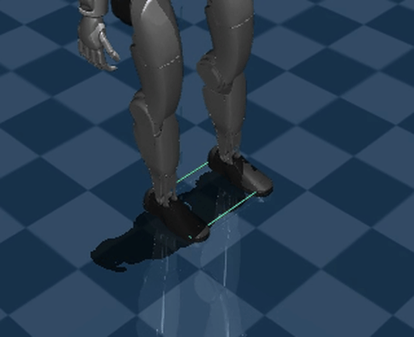
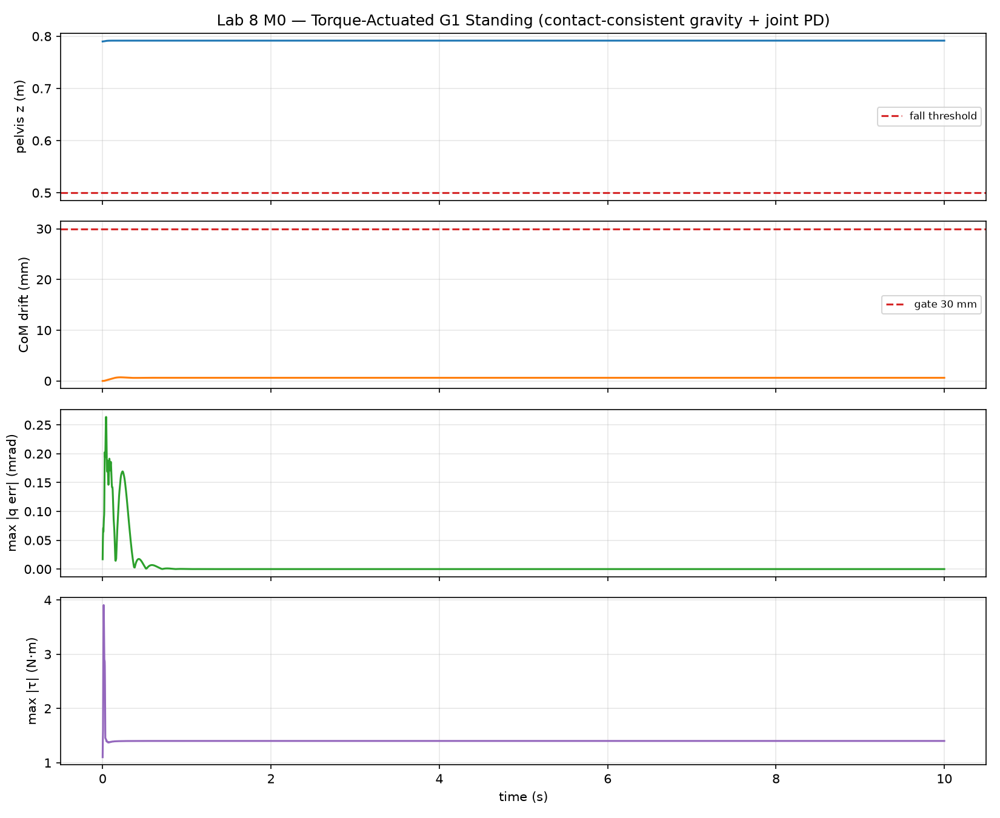
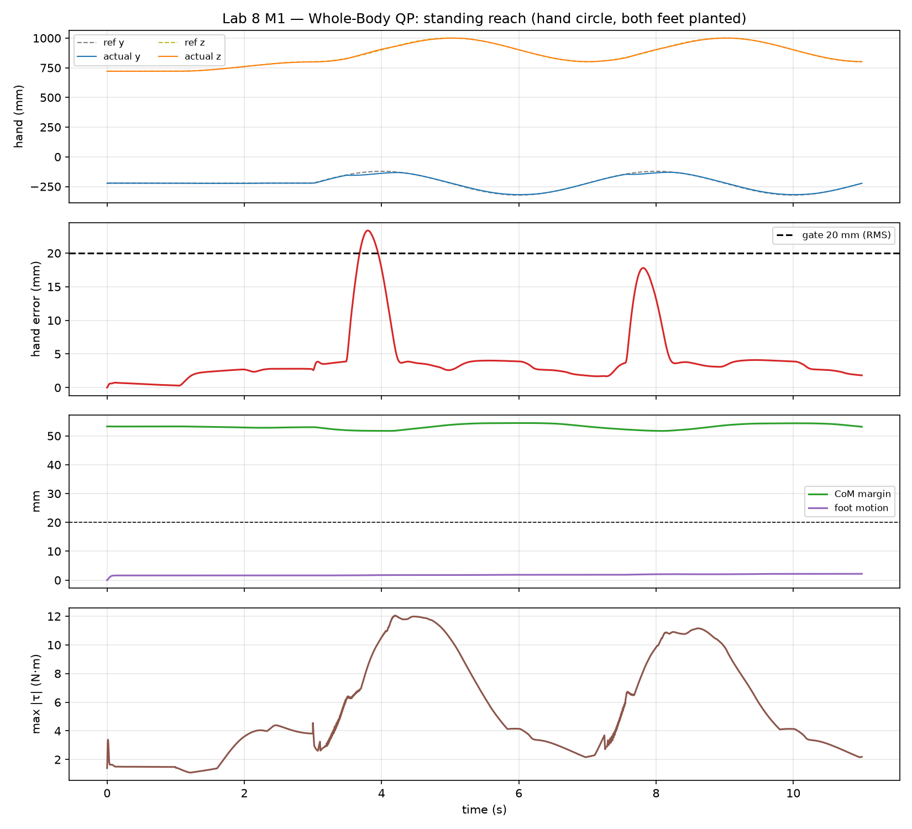
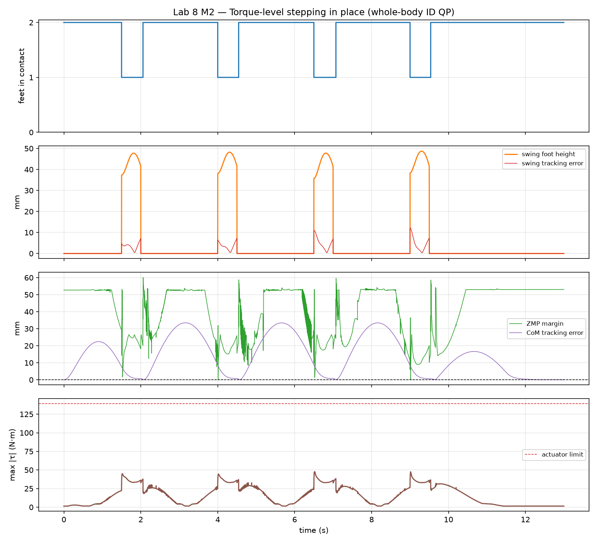
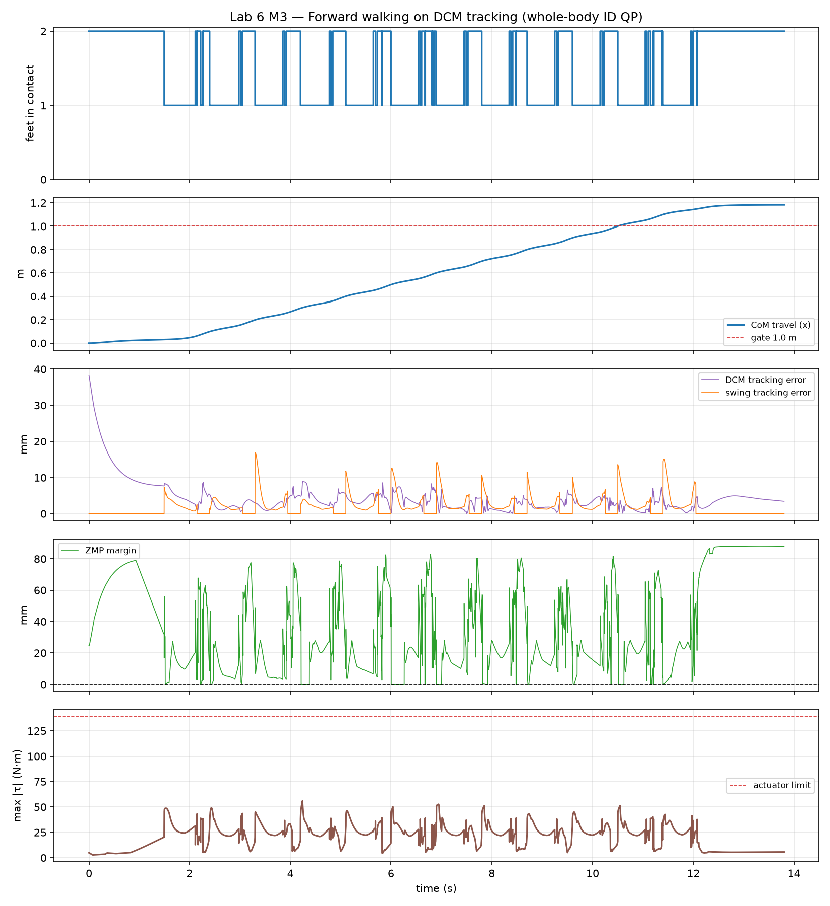

# Lab 6: 全身行走控制

[English](GALLERY.md) · [한국어](GALLERY.ko.md) · [简体中文](GALLERY.zh-CN.md)

观察单脚与双脚支撑区域的切换，以及 DCM（紫色）和接触 ZMP（橙色）的变化（1 倍速）。

[原始视频 / 图像](media/m3_walking.mp4)

## 图表

原始数据（可选）

- [media/m3_walking_summary.json](media/m3_walking_summary.json)

