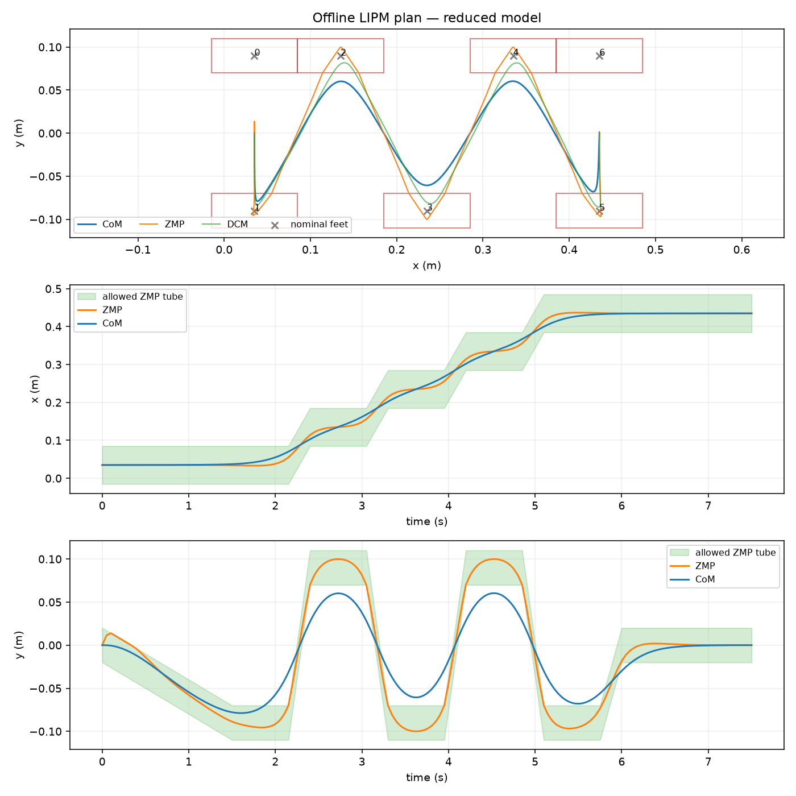
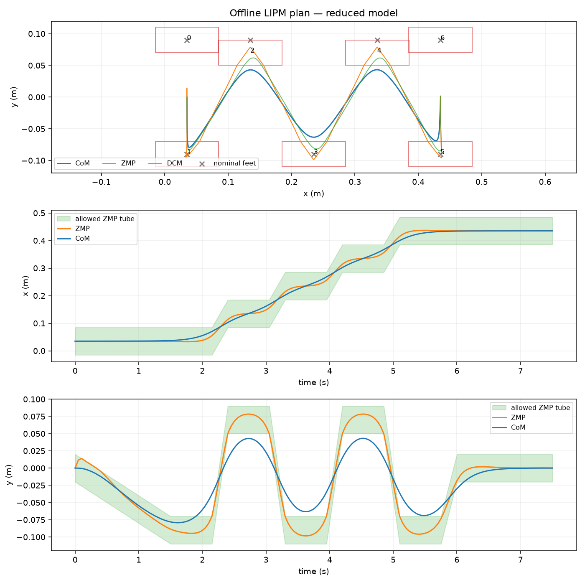
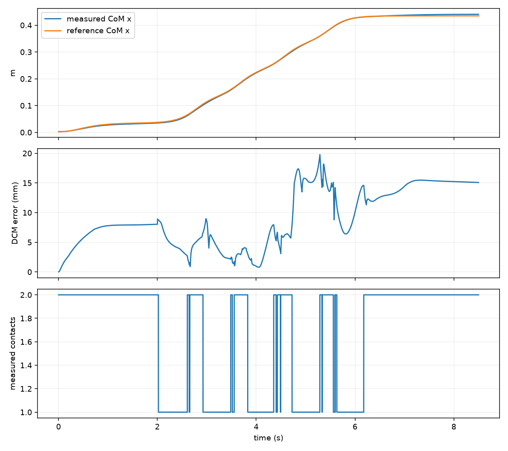

# Lab 7: 보행 궤적 최적화

[English](GALLERY.md) · [한국어](GALLERY.ko.md) · [简体中文](GALLERY.zh-CN.md)

초기 발 디딤(회색), 최적화된 발 디딤·CoM(보라), 실제 CoM(청록)을 비교하세요. 실행 중 계획은 고정됩니다.

[원본 영상 / 이미지](media/g1/optimized_feet/walk.mp4)

## 그래프

원시 데이터 (선택)

- [optimized_feet/summary.json](media/g1/optimized_feet/summary.json)

