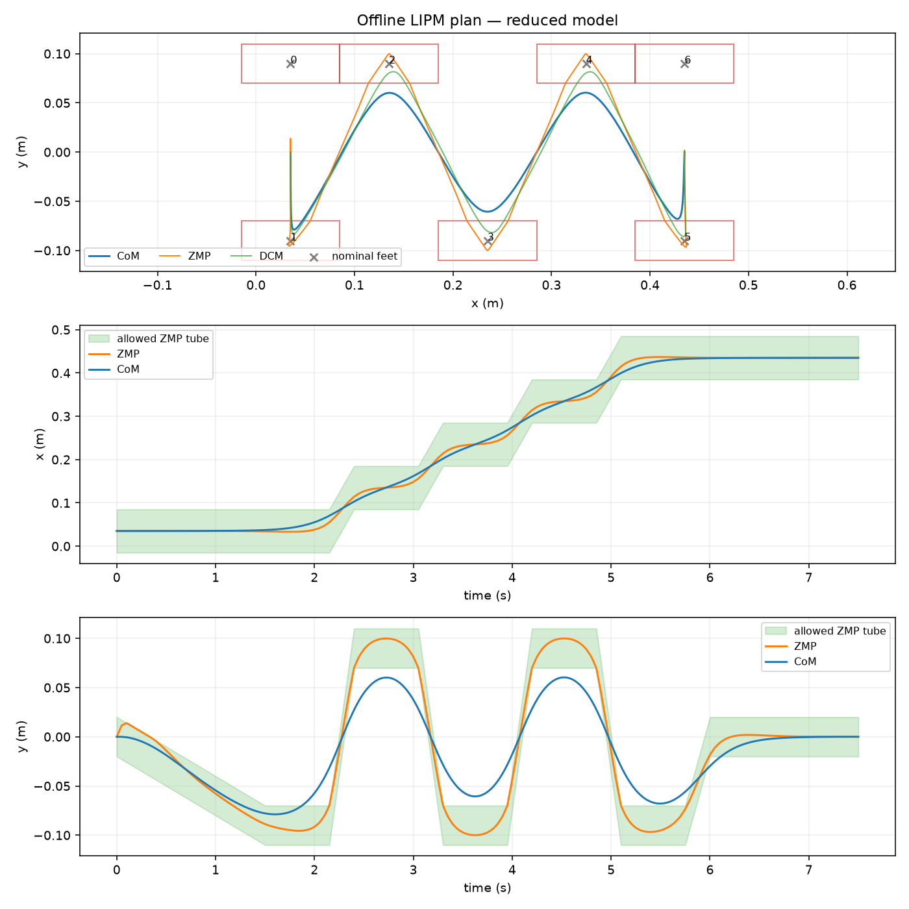
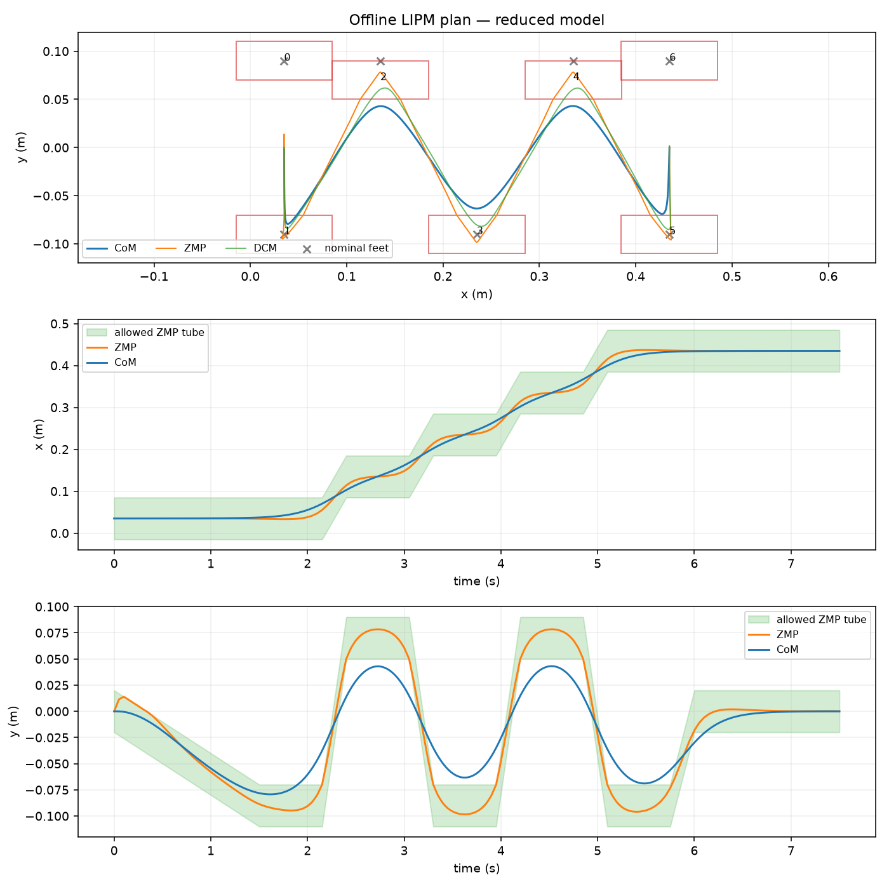
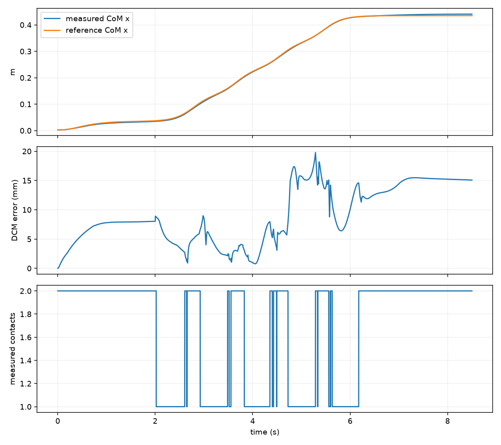

# Lab 7: Walking Trajectory Optimization

[English](README.md) · [한국어](README.ko.md) · [简体中文](README.zh-CN.md)

Optimized feet + CoM tracked in MuJoCo: 5/5 swings; final CoM error 15.15 mm.

[Source recording / image](media/g1/optimized_feet/walk.mp4)

## Measurements

- [optimized_feet/summary.json](media/g1/optimized_feet/summary.json)

## Exercises

### trajectory

### trajectory

### tracking

