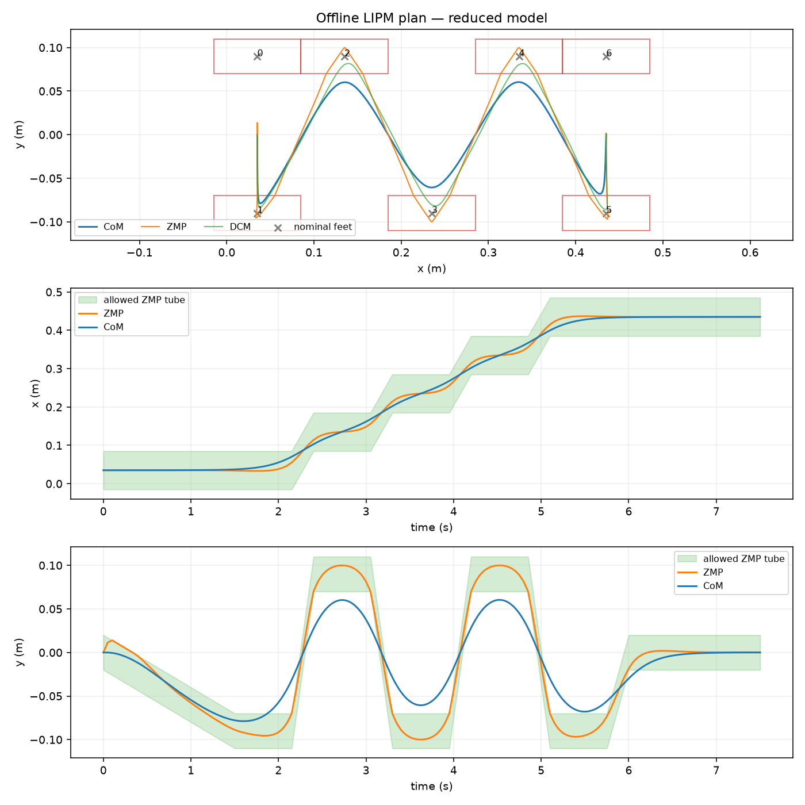
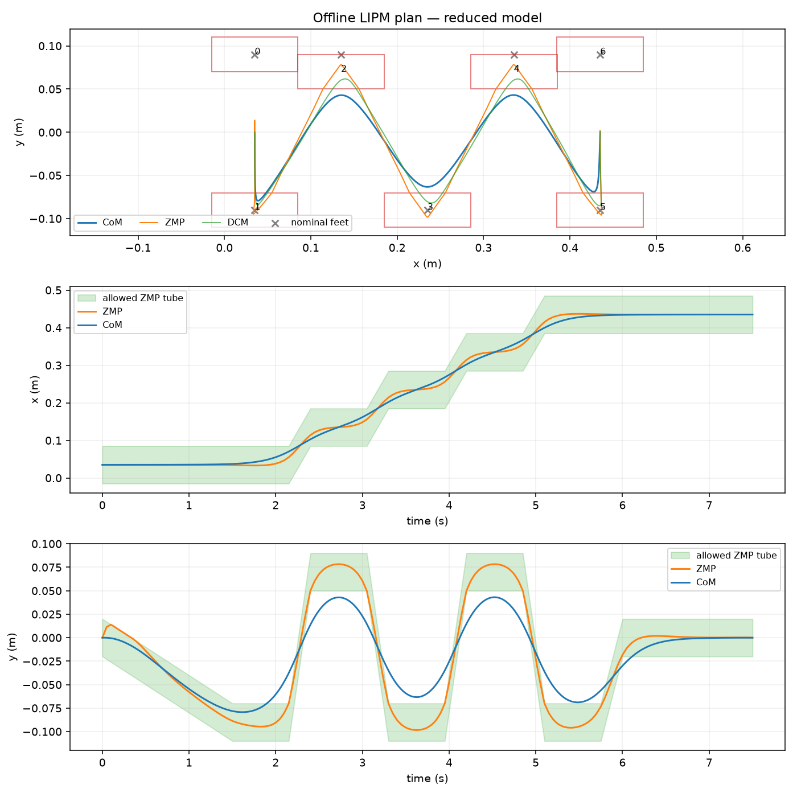
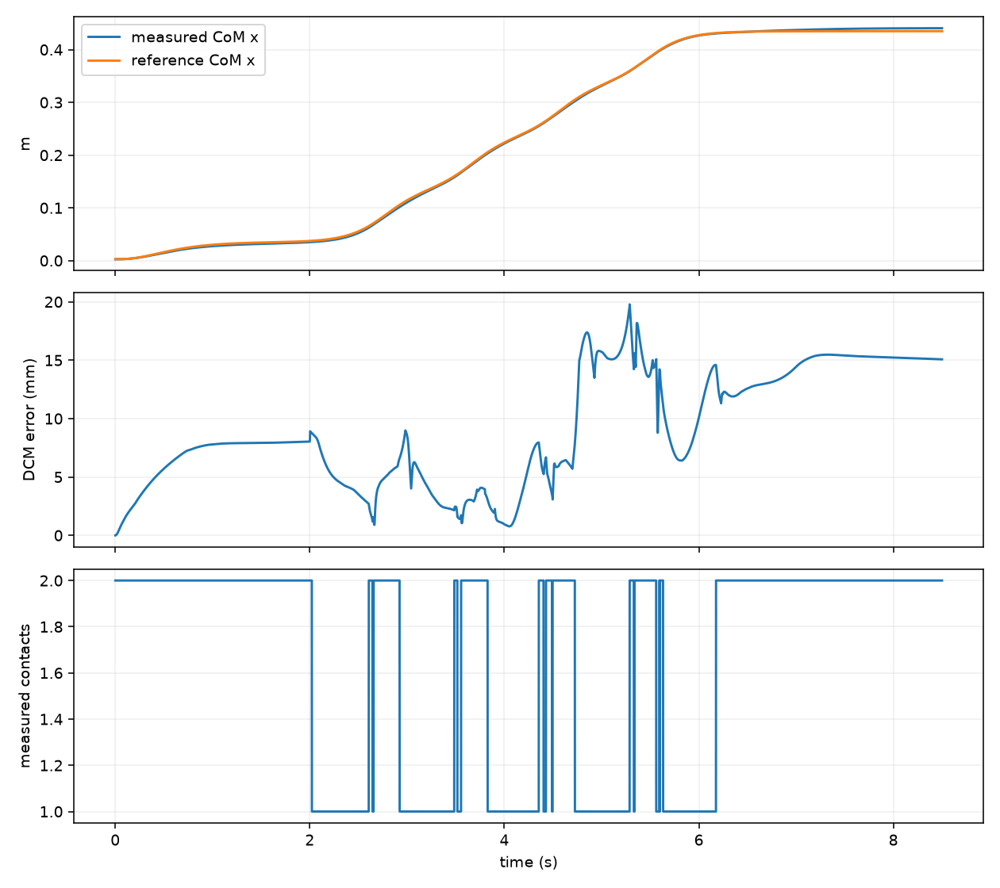

# Lab 7: 行走轨迹优化

[English](GALLERY.md) · [한국어](GALLERY.ko.md) · [简体中文](GALLERY.zh-CN.md)

放大、0.7 倍速：比较灰色初始脚印与紫色优化落脚点及 CoM。青色为实际运动，执行期间计划保持不变。

[原始视频 / 图像](media/g1/optimized_feet/walk.mp4)

## 图表

原始数据（可选）

- [optimized_feet/summary.json](media/g1/optimized_feet/summary.json)

