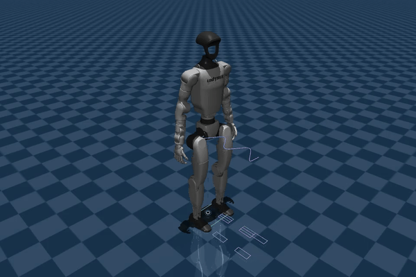

# Lab 7: 보행 궤적 최적화

[English](README.md) · [한국어](README.ko.md) · [简体中文](README.zh-CN.md)

Offline LIPM 궤적·발 디딤·시간 후보를 최적화하고 G1에서 추종합니다.



확대·0.7배속: 회색 초기 발자국과 보라 최적화 발 디딤·CoM을 비교하세요. 청록은 실제 움직임이며 실행 중 계획은 고정됩니다.

[데모](GALLERY.ko.md) · [학습 노트](docs/README.ko.md) · [시각화 읽는 법](../docs/VISUAL_GUIDE.ko.md)

## 실행

[설치](../docs/SETUP.ko.md)

```bash
python lab-7-walking-optimization/src/offline_walk.py --compare
python lab-7-walking-optimization/src/g1_walk.py --mode optimized --optimize-feet --video
```

고정된 접촉 순서의 오프라인 발 디딤·시간 최적화입니다.

```bash
python -m pytest lab-7-walking-optimization/tests -q
```

[← Curriculum](../README.ko.md)
