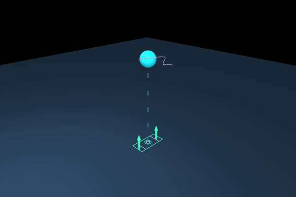
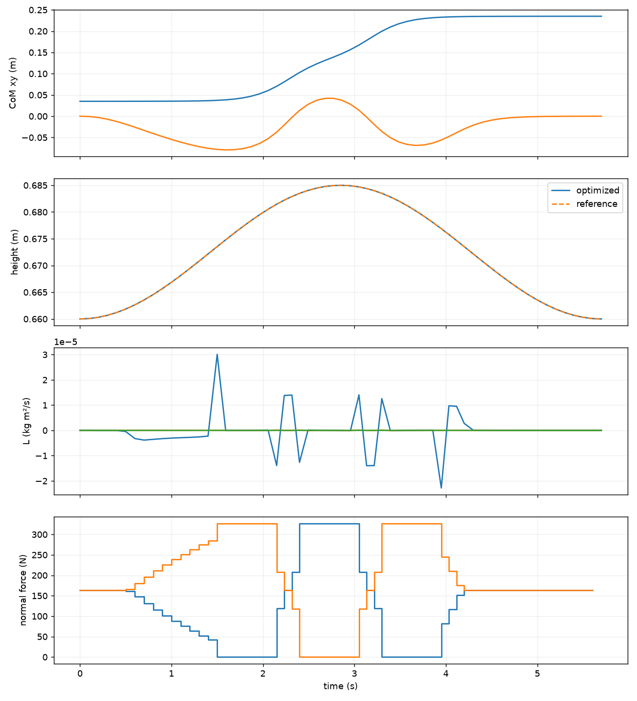

# Lab 8: Centroidal 최적화

[English](GALLERY.md) · [한국어](GALLERY.ko.md) · [简体中文](GALLERY.zh-CN.md)

접촉력 화살표와 질량 중심의 높이·각운동량 변화를 보세요. 최적화된 축소 모델의 애니메이션이며 로봇 rollout은 아닙니다.

[원본 영상 / 이미지](media/offline/centroidal.mp4)

## 그래프

원시 데이터 (선택)

- [offline/metrics.json](media/offline/metrics.json)
- [media/pinocchio.json](media/pinocchio.json)
- [offline/animation_summary.json](media/offline/animation_summary.json)

