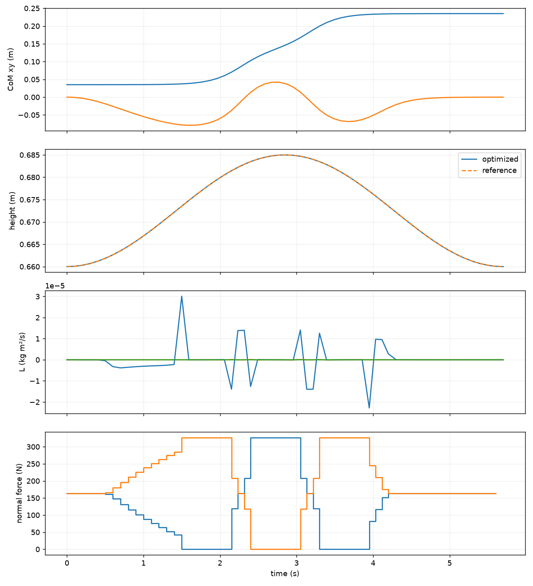

# Lab 8: Centroidal Optimization

[English](README.md) · [한국어](README.ko.md) · [简体中文](README.zh-CN.md)

Reduced-model optimization: CoM height, momentum and contact forces. Not a robot rollout.

[Source recording / image](media/offline/centroidal.png)

## Measurements

- [offline/metrics.json](media/offline/metrics.json)

- [media/pinocchio.json](media/pinocchio.json)

## Exercises

### centroidal

