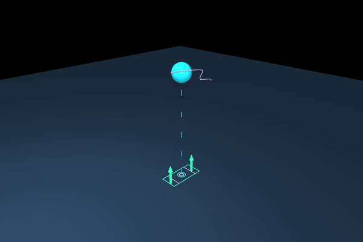
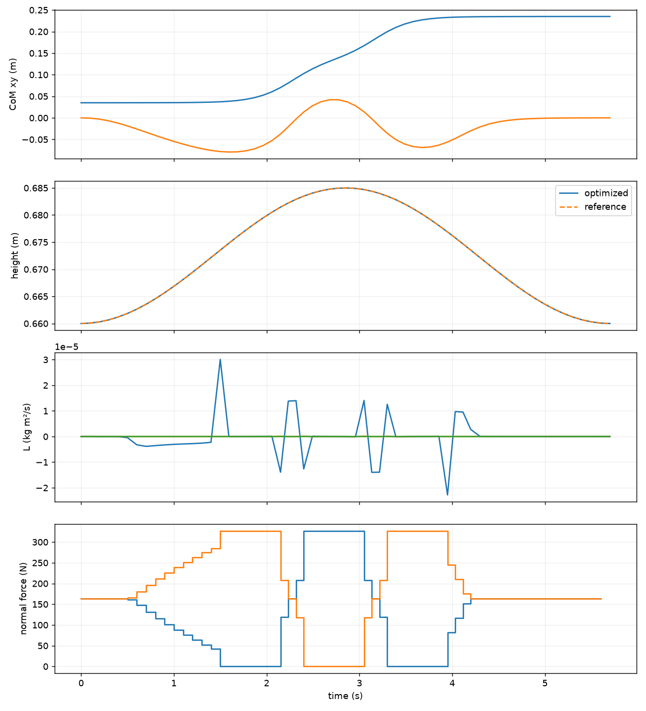

# Lab 8: Centroidal 优化

[English](GALLERY.md) · [한국어](GALLERY.ko.md) · [简体中文](GALLERY.zh-CN.md)

观察接触力箭头、质心高度及角动量的变化。这是优化后的简化模型动画，不是机器人 rollout。

[原始视频 / 图像](media/offline/centroidal.mp4)

## 图表

原始数据（可选）

- [offline/metrics.json](media/offline/metrics.json)
- [media/pinocchio.json](media/pinocchio.json)
- [offline/animation_summary.json](media/offline/animation_summary.json)

