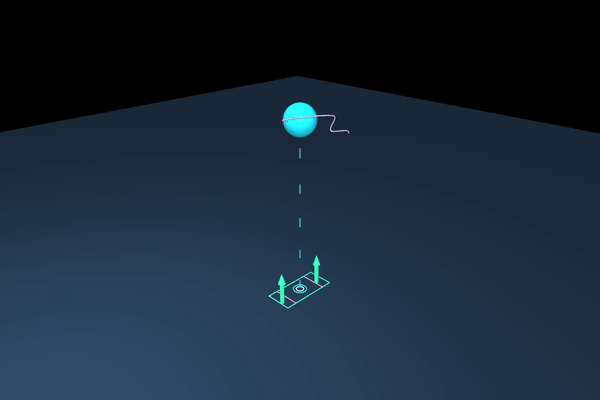

# Lab 8: Centroidal 최적화

[English](README.md) · [한국어](README.ko.md) · [简体中文](README.zh-CN.md)

Nonlinear multiple shooting으로 CoM 높이·운동량·contact wrench를 최적화합니다.



접촉력 화살표와 질량 중심의 높이·각운동량 변화를 보세요. 최적화된 축소 모델의 애니메이션이며 로봇 rollout은 아닙니다.

[실습과 측정 결과](GALLERY.md) · [학습 노트](docs/README.md) · [시각화 읽는 법](../docs/VISUAL_GUIDE.ko.md)

## 실행

[설치](../docs/SETUP.md)

```bash
python lab-8-centroidal-optimization/src/offline_centroidal.py
python lab-8-centroidal-optimization/src/render_centroidal.py
```

평지의 고정 접촉을 사용하는 축소 모델입니다. 전신 실행 가능성은 별도로 검증합니다.

```bash
python -m pytest lab-8-centroidal-optimization/tests -q
```

[← Curriculum](../README.ko.md)
