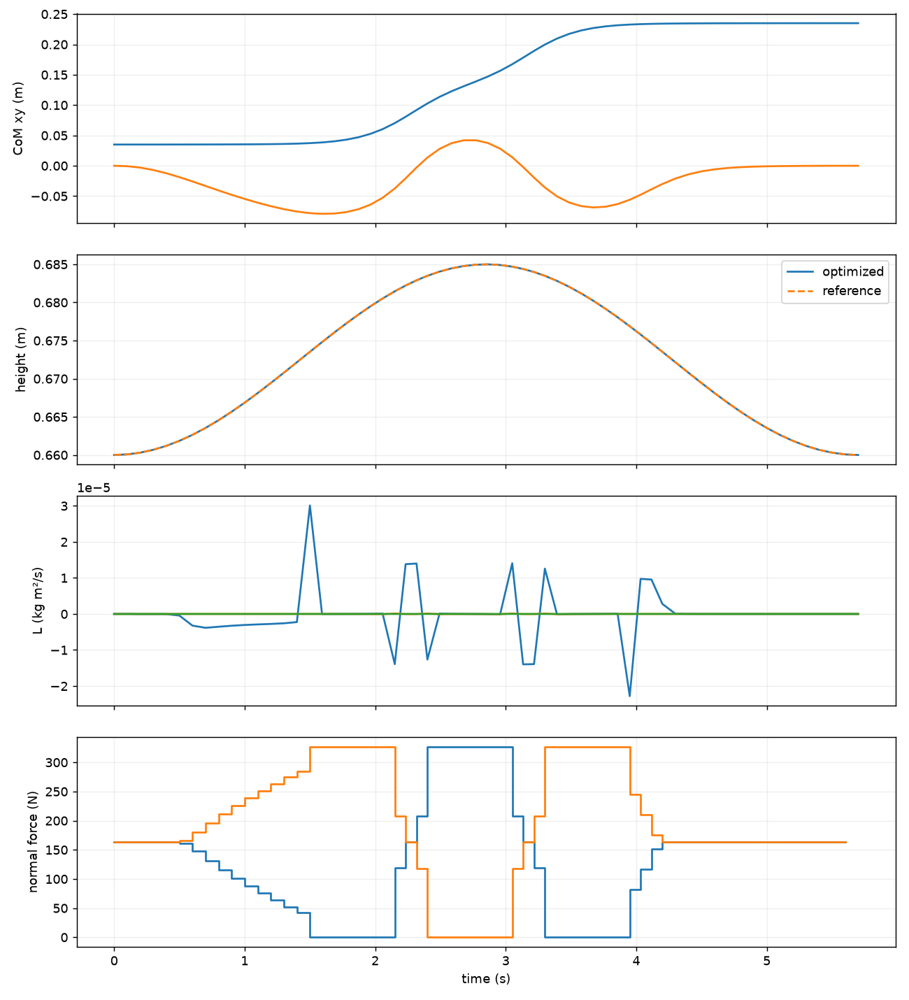

# Lab 8: Centroidal Optimization

[English](README.md) · [한국어](README.ko.md) · [简体中文](README.zh-CN.md)

Optimize CoM height, momentum and contact wrenches with nonlinear multiple shooting.



Reduced-model optimization: CoM height, momentum and contact forces. Not a robot rollout.

[Exercises and measurements](GALLERY.md) · [Study notes](docs/README.md)

## Run

[Setup](../docs/SETUP.md)

```bash
python lab-8-centroidal-optimization/src/offline_centroidal.py
```

The reduced model uses fixed flat-ground contacts; validate whole-body feasibility separately.

```bash
python -m pytest lab-8-centroidal-optimization/tests -q
```

[← Curriculum](../README.md)
