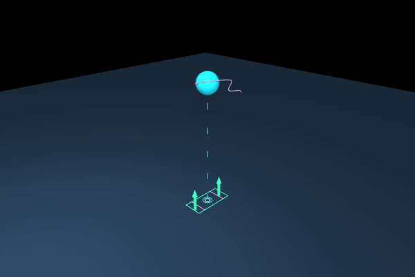

# Lab 8: Centroidal 优化

[English](README.md) · [한국어](README.ko.md) · [简体中文](README.zh-CN.md)

使用 nonlinear multiple shooting 优化 CoM 高度、动量和 contact wrench。



观察接触力箭头、质心高度及角动量的变化。这是优化后的简化模型动画，不是机器人 rollout。

[演示](GALLERY.zh-CN.md) · [学习笔记](docs/README.zh-CN.md) · [可视化指南](../docs/VISUAL_GUIDE.zh-CN.md)

## 运行

[安装](../docs/SETUP.zh-CN.md)

```bash
python lab-8-centroidal-optimization/src/offline_centroidal.py
python lab-8-centroidal-optimization/src/render_centroidal.py
```

简化模型使用平地固定接触；全身可行性需单独验证。

```bash
python -m pytest lab-8-centroidal-optimization/tests -q
```

[← Curriculum](../README.zh-CN.md)
