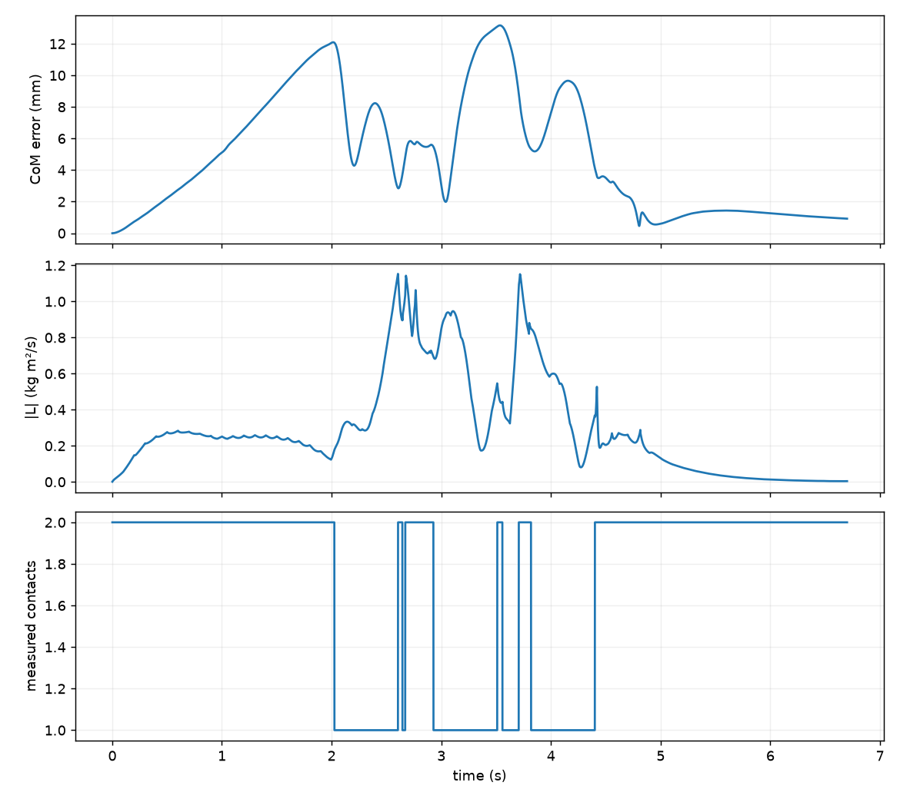
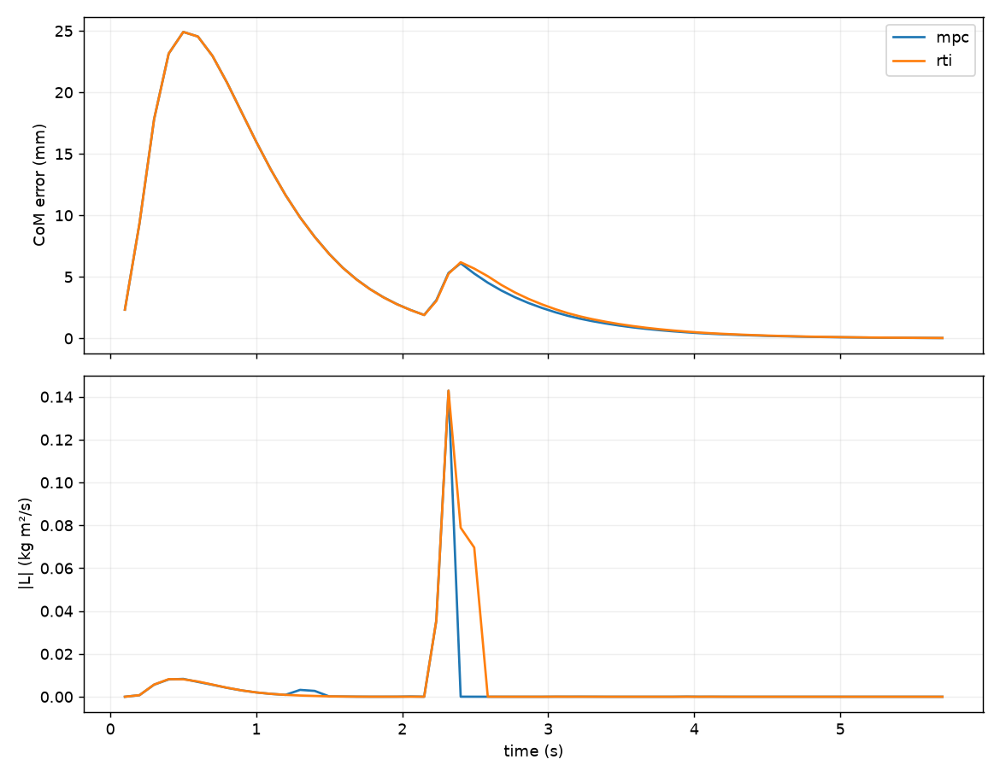

# Lab 9: MPC·RTI·관측 강인성

[English](GALLERY.md) · [한국어](GALLERY.ko.md) · [简体中文](GALLERY.zh-CN.md)

보라 구와 궤적은 현재 CoM 예측, 회색은 원래 계획입니다. 빨간 외란 화살표 전후로 예측이 어떻게 달라지는지 보세요.

[원본 영상 / 이미지](media/g1/rti/mpc.mp4)

## 그래프

원시 데이터 (선택)

- [rti/summary.json](media/g1/rti/summary.json)
- [validated_scenarios/matrix.json](media/validated_scenarios/matrix.json)
- [observation_benchmark/matrix.json](media/observation_benchmark/matrix.json)

