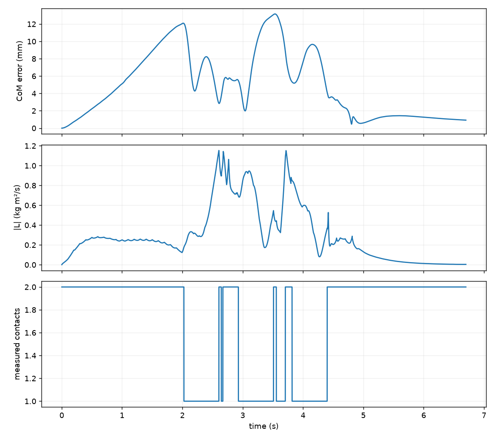
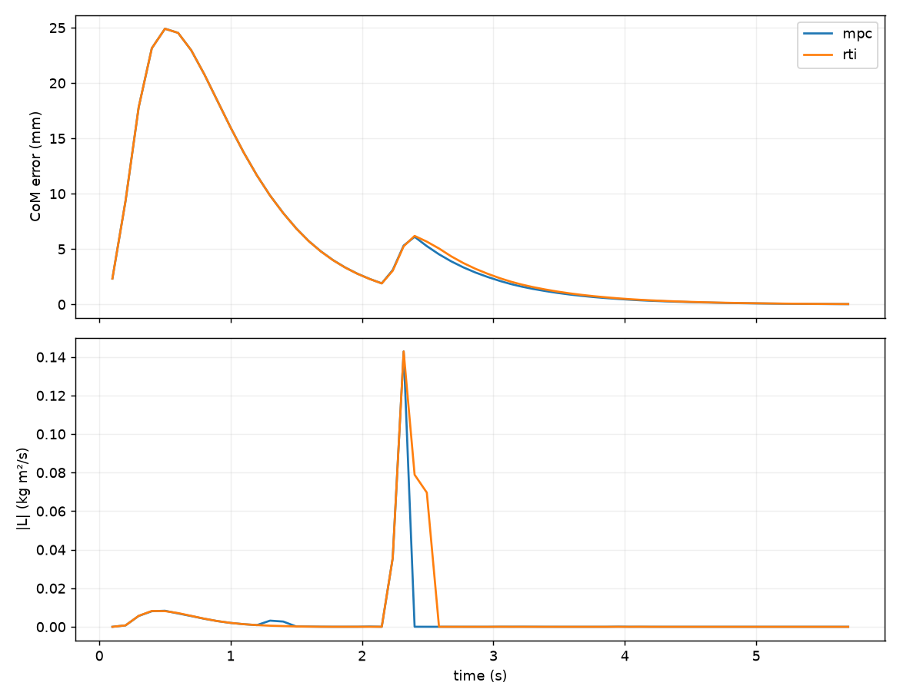

# Lab 9: MPC, RTI & Observation Robustness

[English](GALLERY.md) · [한국어](GALLERY.ko.md) · [简体中文](GALLERY.zh-CN.md)

Push-response close-up, 0.25×: violet CoM predictions change around the red push; gray remains the nominal plan. This predicts CoM, not future joint poses.

[Source recording / image](media/g1/rti/mpc.mp4)

## Plots

Raw data (optional)

- [rti/summary.json](media/g1/rti/summary.json)
- [validated_scenarios/matrix.json](media/validated_scenarios/matrix.json)
- [observation_benchmark/matrix.json](media/observation_benchmark/matrix.json)

