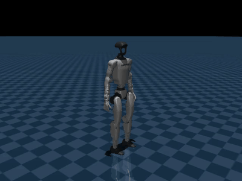
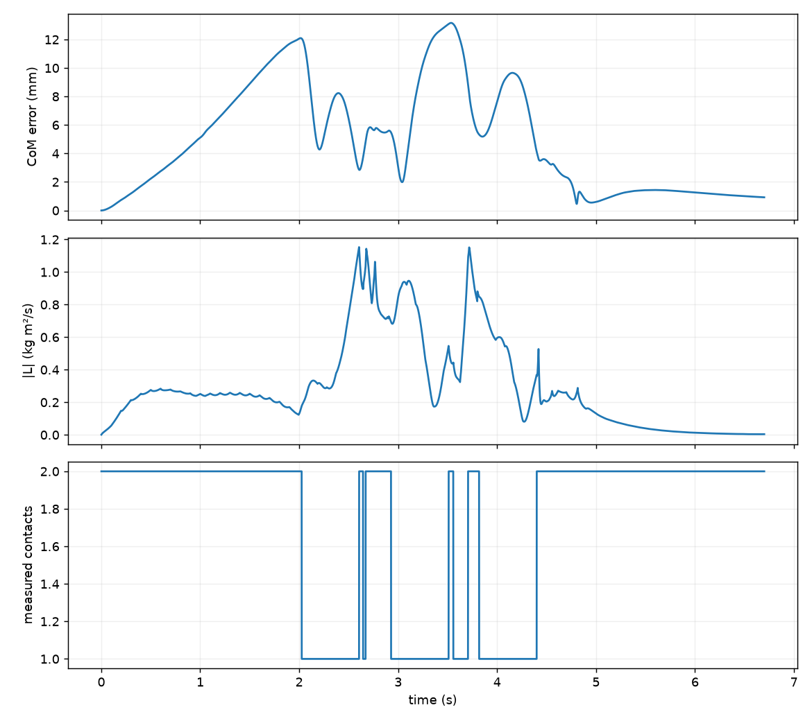
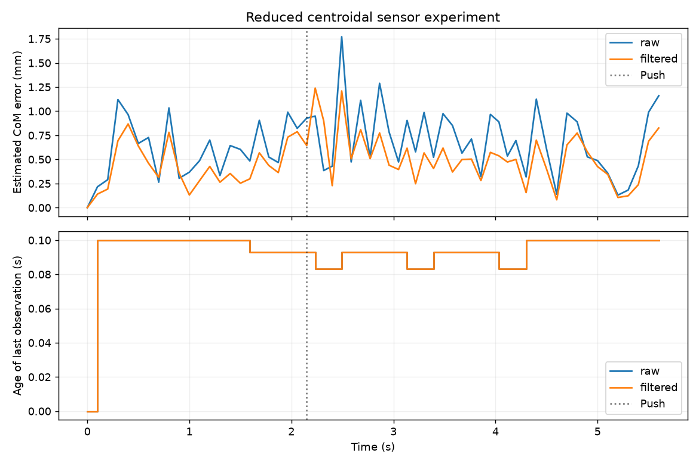
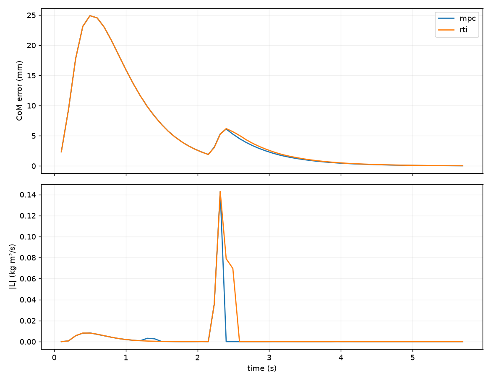

# Lab 9: MPC、RTI 与观测鲁棒性

[English](GALLERY.md) · [한국어](GALLERY.ko.md) · [简体中文](GALLERY.zh-CN.md)

外力响应特写、0.25 倍速：紫色 CoM 预测随红色外力变化，灰色仍为原计划。这里预测 CoM，而非未来关节姿态。

[原始视频 / 图像](media/g1/rti/mpc.mp4)

## 图表

原始数据（可选）

- [rti/summary.json](media/g1/rti/summary.json)
- [validated_scenarios/matrix.json](media/validated_scenarios/matrix.json)
- [observation_benchmark/matrix.json](media/observation_benchmark/matrix.json)

